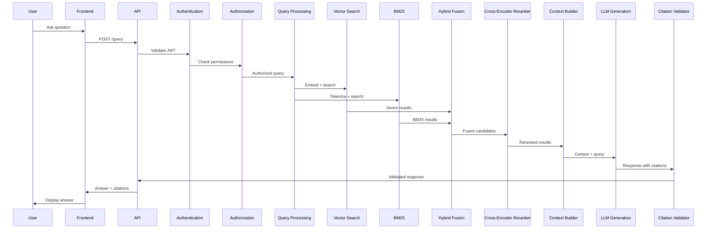
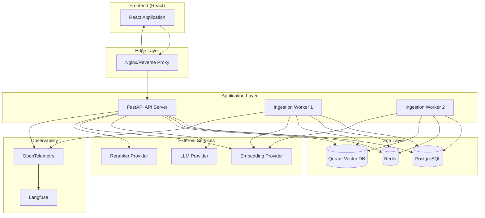
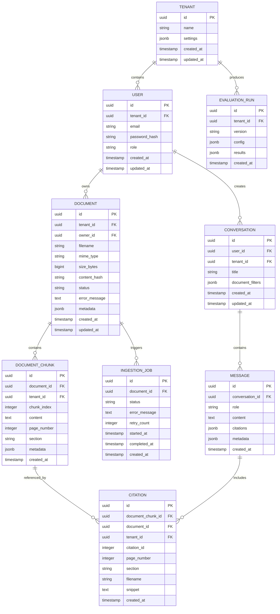
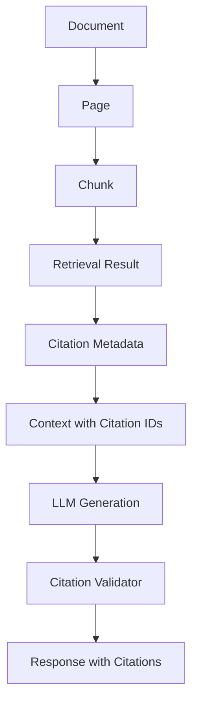
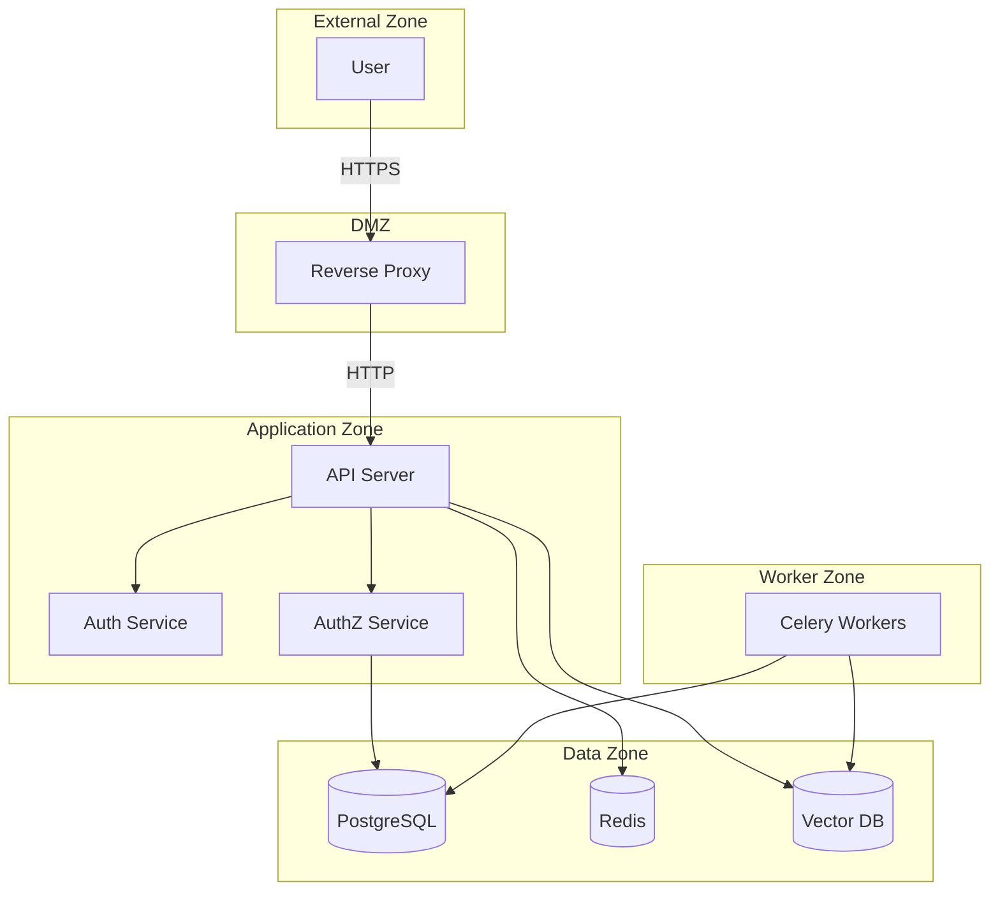

# Architecture Specification

**Ask My Docs — Production RAG Application**

---

# Architecture Overview

Ask My Docs implements a production-grade RAG architecture with clear separation of concerns across ingestion, retrieval, generation, and infrastructure layers. The design prioritizes security (authorization before context construction), modularity (replaceable providers), and observability (inspectable retrieval behavior).

---

# High-Level Architecture

## Query Flow



## Document Ingestion Flow

```mermaid
sequenceDiagram
    participant User
    participant API
    participant Queue as Job Queue
    participant Worker as Ingestion Worker
    participant Parser as Parser
    participant Chunker as Chunker
    participant Embedder as Embedder
    participant VDB as Vector DB
    participant BM25 as BM25 Index
    participant DB as PostgreSQL

    User->>API: Upload document
    API->>DB: Register document (UPLOADED)
    API->>Queue: Enqueue ingestion job
    API->>User: Return document ID

    Queue->>Worker: Dequeue job
    Worker->>DB: Update status (VALIDATING)
    Worker->>Parser: Parse document
    Parser->>Worker: Parsed content

    Worker->>DB: Update status (PROCESSING)
    Worker->>Chunker: Chunk content
    Chunker->>Worker: Chunks with metadata

    Worker->>Embedder: Embed chunks
    Embedder->>Worker: Embeddings

    Worker->>DB: Update status (INDEXING)
    Worker->>VDB: Store embeddings
    Worker->>BM25: Index for BM25
    Worker->>DB: Update status (READY)
```



## Production Infrastructure



---

# Component Architecture

## Frontend (React)

**Responsibilities:**
- User interface for document upload, query, and conversation management
- Display answers with citations
- Authentication flow (login, register, logout)
- Document management interface

**Interfaces:**
- REST API communication with backend
- JWT token management
- Streaming response handling (future)

## API (FastAPI)

**Responsibilities:**
- HTTP request handling and routing
- Request validation and serialization
- Authentication and authorization middleware
- Rate limiting
- Error handling and response formatting
- Health check endpoints

**Interfaces:**
- REST endpoints for all operations
- JWT token validation
- Database queries via repository pattern
- Queue publishing for async operations

## Authentication Service

**Responsibilities:**
- User registration and login
- JWT token generation and validation
- Refresh token management
- Password hashing and verification

**Interfaces:**
- User repository for credential storage
- Token blacklist for logout

## Authorization Service

**Responsibilities:**
- Role-based access control enforcement
- Document permission checking
- Tenant isolation validation
- Permission caching

**Interfaces:**
- Permission repository
- User/tenant relationship queries

## Document Service

**Responsibilities:**
- Document CRUD operations
- Document status management
- Duplicate detection
- Document metadata management

**Interfaces:**
- Document repository
- Ingestion queue publishing
- Storage backend for file storage

## Ingestion Service

**Responsibilities:**
- Document parsing (PDF, DOCX, TXT, Markdown, HTML)
- Content cleaning and normalization
- Structure detection and preservation
- Chunking with configurable parameters
- Metadata extraction
- Embedding generation
- Vector and BM25 indexing
- Retry handling and failure management

**Interfaces:**
- Parser implementations per format
- Embedder provider abstraction
- Vector DB client
- BM25 indexer
- Document repository for status updates

## Parser

**Responsibilities:**
- Format-specific document parsing
- OCR fallback when text extraction insufficient
- Content extraction with structure preservation
- Metadata extraction (title, author, creation date)

**Interfaces:**
- PDF: PyMuPDF or equivalent
- DOCX: python-docx or equivalent
- TXT/Markdown: Direct reading
- HTML: BeautifulSoup or equivalent
- OCR: Tesseract or cloud OCR

## Chunker

**Responsibilities:**
- Text splitting with configurable parameters
- Recursive text splitting (recommended)
- Overlap management
- Chunk metadata attachment
- Min/max chunk size enforcement

**Interfaces:**
- Input: Parsed content with structure
- Output: Chunks with metadata

## Embedding Service

**Responsibilities:**
- Provider abstraction for embedding models
- Batch embedding with configurable batch size
- Dimension validation
- Rate limiting for API-based providers
- Caching for repeated content

**Interfaces:**
- Provider interface: embed(texts) -> vectors
- Model version tracking
- Dimension compatibility checks

## Vector Database (Qdrant or pgvector)

**Responsibilities:**
- Vector storage and indexing
- Similarity search
- Metadata filtering
- Collection/index management
- Persistence and backup

**Interfaces:**
- Collection per tenant or shared with filtering
- Vector CRUD operations
- Search with filters

## BM25 Index

**Responsibilities:**
- Keyword-based document indexing
- Tokenization and stemming
- BM25 scoring
- Index updates on document changes

**Interfaces:**
- Elasticsearch, SQLite FTS, or equivalent
- Configurable tokenization
- Index per tenant or shared

## Hybrid Retrieval

**Responsibilities:**
- Combine vector and BM25 results
- Reciprocal Rank Fusion (recommended)
- Score normalization
- Candidate deduplication

**Interfaces:**
- Input: Vector results + BM25 results
- Output: Fused and ranked candidates

## Reranker (Cross-Encoder)

**Responsibilities:**
- Precision reranking of candidates
- Query-chunk relevance scoring
- Fallback to fusion ranking on failure
- Model abstraction

**Interfaces:**
- Provider interface: rerank(query, chunks) -> scored_chunks
- Model version tracking

## Context Builder

**Responsibilities:**
- Order chunks by relevance
- Apply token budget limits
- Include citation metadata
- Deduplicate near-identical content
- Format context for LLM

**Interfaces:**
- Input: Reranked chunks + token budget
- Output: Formatted context with citation IDs

## LLM Provider

**Responsibilities:**
- Provider abstraction for language models
- Structured output generation
- Citation instruction enforcement
- Token usage tracking
- Rate limiting

**Interfaces:**
- Provider interface: generate(prompt, context) -> response
- Model version tracking
- Token counting

## Citation Engine

**Responsibilities:**
- Citation ID management
- Citation validation against retrieved context
- Citation metadata extraction
- Invalid citation detection
- Citation format enforcement

**Interfaces:**
- Input: LLM response + context
- Output: Validated response with citations

## Evaluation Service

**Responsibilities:**
- Golden dataset management
- Metric calculation (retrieval, generation, system)
- Baseline comparison
- Regression detection
- Report generation

**Interfaces:**
- Evaluation dataset repository
- Metric calculators
- Report storage

## PostgreSQL

**Responsibilities:**
- Primary data storage
- User and tenant management
- Document metadata storage
- Conversation history
- Citation storage
- Schema migrations

**Interfaces:**
- SQLAlchemy or equivalent ORM
- Alembic for migrations
- Connection pooling

## Redis

**Responsibilities:**
- Celery task queue broker
- Caching layer (sessions, permissions)
- Rate limiting storage
- Token blacklist

**Interfaces:**
- Celery broker connection
- Cache client
- Rate limiter

## Workers (Celery)

**Responsibilities:**
- Background document ingestion
- Retry handling with exponential backoff
- Dead letter queue for permanent failures
- Worker health monitoring

**Interfaces:**
- Celery task definitions
- Database access for status updates
- Vector DB and BM25 access for indexing

## Observability

**Responsibilities:**
- Structured logging
- Distributed tracing
- Custom metrics export
- Retrieval score inspection
- Citation failure tracking

**Interfaces:**
- OpenTelemetry SDK
- Langfuse integration
- Prometheus metrics endpoint

---

# Technology Decisions

## Backend: Python + FastAPI

**Why:**
- Native async support for I/O-bound operations
- Type hints with Pydantic for request/response validation
- High performance comparable to Node.js
- Rich ecosystem for ML/AI libraries
- OpenAPI documentation generation

**Alternatives:**
- Django: Heavier, less async-native
- Node.js: Weaker ML ecosystem
- Go: Less ML library support

**Trade-offs:**
- GIL limits CPU-bound parallelism (mitigated by workers)
- Requires careful async/await usage

## Database: PostgreSQL

**Why:**
- ACID compliance for data integrity
- JSON support for flexible metadata
- pgvector extension for vector storage
- Mature migration tooling (Alembic)
- Battle-tested in production

**Alternatives:**
- MySQL: Less feature-rich
- MongoDB: Weaker relational integrity

**Trade-offs:**
- Vertical scaling limits (acceptable for initial scale)
- Requires connection pooling

## Vector Database: pgvector or Qdrant

**Why:**
- pgvector: Single database, simpler operations
- Qdrant: Better performance at scale, native filtering

**Recommendation:** Start with pgvector for simplicity, migrate to Qdrant if performance requires.

**Alternatives:**
- Pinecone: Managed, less control
- Weaviate: Heavier infrastructure

**Trade-offs:**
- pgvector: Simpler but slower at scale
- Qdrant: Better performance but separate infrastructure

## Keyword Search: BM25

**Why:**
- Complementary to vector search
- Good for exact term matching
- Well-understood algorithm

**Implementation Options:**
- Elasticsearch: Feature-rich but heavy
- SQLite FTS: Lightweight, embedded
- PostgreSQL full-text: Integrated with main DB

**Recommendation:** Start with PostgreSQL full-text, migrate to Elasticsearch if needed.

## Cache/Queue: Redis

**Why:**
- Fast in-memory storage
- Native Celery broker support
- Pub/sub for real-time features
- TTL support for caching

**Alternatives:**
- RabbitMQ: More complex setup
- PostgreSQL: Slower for queue operations

**Trade-offs:**
- Memory usage for large caches
- Persistence configuration needed

## Workers: Celery

**Why:**
- Mature Python task queue
- Redis broker integration
- Retry handling built-in
- Monitoring with Flower

**Alternatives:**
- Dramatiq: Less mature
- RQ: Simpler but less features
- FastAPI BackgroundTasks: Limited for production

**Trade-offs:**
- Configuration complexity
- Requires separate worker processes

## Reranker: Cross-Encoder

**Why:**
- Significantly improves precision
- Well-established in RAG architectures
- Multiple model options available

**Alternatives:**
- ColBERT: More complex
- LLM-based reranking: Slower, more expensive

**Trade-offs:**
- Additional latency (mitigated by small candidate set)
- Model hosting or API costs

## LLM: Provider Abstraction

**Why:**
- No vendor lock-in
- Cost optimization across providers
- Model selection based on task
- Fallback on provider outage

**Implementation:**
- Abstract interface for generate()
- Configuration for model selection
- Token counting abstraction

## Embeddings: Provider Abstraction

**Why:**
- Same benefits as LLM abstraction
- Dimension compatibility validation
- Cost optimization

**Implementation:**
- Abstract interface for embed()
- Dimension registry for compatibility
- Batch processing abstraction

## Frontend: React

**Why:**
- Large ecosystem
- Component-based architecture
- Good for interactive UIs
- TypeScript support

**Alternatives:**
- Vue: Simpler but smaller ecosystem
- Svelte: Newer, less mature

**Trade-offs:**
- Build complexity
- Bundle size

## Containerization: Docker

**Why:**
- Consistent development/production environments
- Easy scaling with orchestration
- Isolation of services
- Standard deployment format

**Alternatives:**
- Podman: Docker-compatible
- Nix: More reproducible but steeper learning curve

**Trade-offs:**
- Image size optimization needed
- Security scanning required

## CI: GitHub Actions

**Why:**
- Native GitHub integration
- Free for public repositories
- Marketplace for actions
- Secrets management

**Alternatives:**
- GitLab CI: If using GitLab
- CircleCI: More features but paid

**Trade-offs:**
- Vendor lock-in to GitHub
- Limited free minutes for private repos

## Observability: OpenTelemetry + Langfuse

**Why:**
- OpenTelemetry: Standard, vendor-agnostic
- Langfuse: RAG-specific evaluation and tracing
- Complementary capabilities

**Alternatives:**
- Datadog: All-in-one but expensive
- Jaeger: Tracing only

**Trade-offs:**
- Multiple tools to maintain
- Integration complexity

---

# Database Architecture

## Logical Entities



## Relationships

- **TENANT → USER**: One-to-many (tenant contains users)
- **USER → DOCUMENT**: One-to-many (user owns documents)
- **DOCUMENT → DOCUMENT_CHUNK**: One-to-many (document contains chunks)
- **DOCUMENT_CHUNK → CITATION**: One-to-many (chunk referenced by citations)
- **USER → CONVERSATION**: One-to-many (user creates conversations)
- **CONVERSATION → MESSAGE**: One-to-many (conversation contains messages)
- **DOCUMENT → INGESTION_JOB**: One-to-many (document triggers ingestion jobs)
- **TENANT → EVALUATION_RUN**: One-to-many (tenant produces evaluation runs)

---

# Vector Storage

## Collection/Index Structure

**Option A: pgvector (Recommended for Start)**
```sql
-- Extension
CREATE EXTENSION IF NOT EXISTS vector;

-- Table with vector column
CREATE TABLE document_chunks (
    id UUID PRIMARY KEY,
    tenant_id UUID NOT NULL,
    document_id UUID NOT NULL,
    chunk_index INTEGER NOT NULL,
    content TEXT NOT NULL,
    metadata JSONB,
    embedding VECTOR(1536)  -- Dimension depends on model
);

-- Index for similarity search
CREATE INDEX ON document_chunks
    USING ivfflat (embedding vector_cosine_ops)
    WITH (lists = 100);  -- Configurable

-- Index for filtering
CREATE INDEX ON document_chunks (tenant_id);
CREATE INDEX ON document_chunks (document_id);
```

**Option B: Qdrant**
```json
{
  "collection_name": "document_chunks",
  "vector_size": 1536,
  "distance": "Cosine",
  "on_disk": true
}
```

## Metadata

Every vector record includes:
- `id`: Unique chunk ID
- `tenant_id`: For tenant isolation filtering
- `document_id`: For document-level filtering
- `chunk_index`: Position within document
- `page_number`: Source page (if available)
- `section`: Source section (if available)

## Tenant Filtering

**pgvector:**
```sql
WHERE tenant_id = $1
ORDER BY embedding <=> $2
LIMIT $3
```

**Qdrant:**
```json
{
  "must": [
    {"key": "tenant_id", "match": {"value": "tenant-uuid"}}
  ]
}
```

## Embedding Versioning

**Strategy:**
- Embedding model version stored in configuration
- Re-embedding triggered on model change
- Version field in metadata for tracking

---

# Retrieval Architecture

## Vector Retrieval

```
Query → Embed → Vector Search (top-K=30) → Filter by tenant → Results
```

- Similarity: Cosine (configurable)
- Top-K: Configurable (default 30)
- Filtering: Mandatory tenant_id, optional document_id

## BM25 Retrieval

```
Query → Tokenize → BM25 Search (top-K=30) → Filter by tenant → Results
```

- Tokenization: Configurable (stemming, stop words)
- Top-K: Configurable (default 30)
- Filtering: Mandatory tenant_id

## Hybrid Fusion

**Reciprocal Rank Fusion (Recommended):**
```
RRF_score(d) = Σ 1 / (k + rank_i(d))
```
- k: Configurable constant (default 60)
- Combines rankings from vector and BM25

**Weighted Fusion (Alternative):**
```
final_score = α * vector_score + (1-α) * bm25_score
```
- α: Configurable weight (default 0.7)

## Reranking

```
Fused Candidates → Cross-Encoder Reranker → Scored Results → Top-K (final_K)
```

- Candidate set: Configurable (default 30-50)
- Final K: Configurable (default 5-10)
- Model: Configurable cross-encoder

## Context Construction

```
Reranked Results → Token Budget Check → Citation Metadata → Formatted Context
```

- Token budget: Configurable (default 4096)
- Ordering: By reranker score
- Citation metadata: Included for each chunk

---

# Citation Architecture

## Citation Lifecycle



## Citation Flow

1. **Document Processing**: Chunks created with document_id, chunk_id, page, section
2. **Retrieval**: Chunks returned with citation metadata
3. **Context Construction**: Citation IDs assigned (1, 2, 3...)
4. **LLM Generation**: Model instructed to reference citation IDs
5. **Citation Validation**: IDs validated against context
6. **Response**: Valid citations included with metadata

## Citation Data

Each citation includes:
- `citation_id`: Sequential within response
- `document_id`: Source document
- `chunk_id`: Source chunk
- `filename`: Human-readable filename
- `page`: Page number (if available)
- `section`: Section title (if available)
- `snippet`: Relevant text excerpt

---

# Security Architecture

## Security Boundaries



## Critical Security Principle

**Authorization MUST happen before retrieved context reaches the LLM.**

```
Query → Auth → AuthZ → Retrieval (filtered by permissions) → Context → LLM
```

**Never depend on the LLM to enforce permissions.**

---

# Failure Handling

## Parsing Failure
- **Behavior**: Document marked FAILED, error logged
- **User Impact**: Status visible, retry option available
- **System Impact**: Isolated to single document

## OCR Failure
- **Behavior**: Falls back to text-only content
- **User Impact**: Reduced quality for scanned documents
- **System Impact**: Document still processed

## Embedding Failure
- **Behavior**: Retry with exponential backoff
- **User Impact**: Delayed processing
- **System Impact**: Document in PROCESSING state

## Vector DB Failure
- **Behavior**: Retry, then fail document
- **User Impact**: Document marked FAILED
- **System Impact**: Isolated to single document

## BM25 Failure
- **Behavior**: Vector search continues, BM25 skipped
- **User Impact**: Reduced retrieval quality
- **System Impact**: Degraded but functional

## Reranker Failure
- **Behavior**: Fall back to fusion ranking
- **User Impact**: Slightly reduced precision
- **System Impact**: Graceful degradation

## LLM Failure
- **Behavior**: Return error response
- **User Impact**: Unable to get answer
- **System Impact**: No data loss

## Citation Failure
- **Behavior**: Invalid citations removed, logged
- **User Impact**: Incomplete citations shown
- **System Impact**: Logged for investigation

## Database Failure
- **Behavior**: Request fails, retry at infrastructure level
- **User Impact**: Service unavailable
- **System Impact**: Health check fails

---

# Scalability

## Local Development
- Single PostgreSQL instance
- Embedded Redis
- pgvector for vector storage
- Single worker process

## Single Server
- PostgreSQL with connection pooling
- Redis for queue and cache
- Qdrant for vector storage (optional)
- 2-4 worker processes

## Production
- PostgreSQL with read replicas
- Redis Cluster
- Qdrant cluster
- Horizontal worker scaling
- Load-balanced API servers

---

# Observability

## Logs
- Structured JSON format
- Request correlation IDs
- Log levels: DEBUG, INFO, WARNING, ERROR, CRITICAL
- No sensitive data (passwords, tokens, PII)

## Metrics
- **API**: Request count, latency, error rate
- **Retrieval**: Vector scores, BM25 scores, fusion scores, reranker scores
- **Generation**: Token usage, latency, cost
- **Citations**: Validation success/failure rate
- **Workers**: Queue depth, processing time, failure rate
- **System**: CPU, memory, disk, network

## Traces
- Request flow across services
- Retrieval pipeline stages
- LLM call duration
- Citation validation timing

## Retrieval Inspection
- Query logged with retrieved chunks
- Scores logged for debugging
- Reranker scores logged
- Context logged for LLM input

---

# Architecture Decision Records

## ADR-01: pgvector over Qdrant for Initial Deployment

**Decision:** Start with pgvector, migrate to Qdrant if needed.

**Rationale:**
- Simpler operations (single database)
- Adequate performance for initial scale
- Easier local development
- Migration path exists

**Consequences:**
- May need migration at scale
- Performance limits at high throughput

## ADR-02: Reciprocal Rank Fusion over Weighted Fusion

**Decision:** Use RRF as default fusion method.

**Rationale:**
- No score normalization needed
- Robust to different score distributions
- Well-established in information retrieval

**Consequences:**
- Less interpretable than weighted fusion
- Parameter k needs tuning

## ADR-03: Authorization Before Retrieval

**Decision:** Enforce permissions before context construction.

**Rationale:**
- Security by design
- No reliance on LLM for access control
- Meets enterprise security requirements

**Consequences:**
- Slightly more complex retrieval pipeline
- Requires permission checking on every query

## ADR-04: Citation Validation Post-Generation

**Decision:** Validate citations after LLM generation, not during.

**Rationale:**
- LLM needs freedom to generate natural responses
- Validation catches invalid citations
- Clean separation of concerns

**Consequences:**
- Invalid citations removed from response
- User sees warning if citations removed

## ADR-05: Celery for Background Processing

**Decision:** Use Celery with Redis broker.

**Rationale:**
- Mature Python task queue
- Good retry handling
- Redis broker simplicity
- Monitoring with Flower

**Consequences:**
- Separate worker processes needed
- Redis dependency for broker

---

# Implementation Dependency Order

The following order ensures each phase builds on the previous:

1. **Database Schema** (PostgreSQL)
   - Users, tenants, roles
   - Documents, chunks
   - Conversations, messages
   - Citations

2. **Authentication** (JWT)
   - Registration, login, logout
   - Token generation and validation
   - Password hashing

3. **Document Management** (API)
   - Upload, list, view, delete
   - Status tracking
   - Duplicate detection

4. **Document Ingestion** (Workers)
   - Parsing pipeline
   - Chunking
   - Embedding
   - Vector indexing
   - BM25 indexing

5. **Retrieval** (Vector + BM25)
   - Vector search
   - BM25 search
   - Hybrid fusion

6. **Reranking** (Cross-Encoder)
   - Reranker integration
   - Fallback handling

7. **Context Construction**
   - Token budget
   - Citation metadata
   - Formatting

8. **LLM Generation**
   - Provider abstraction
   - Structured output
   - Citation instruction

9. **Citation Validation**
   - Validation pipeline
   - Invalid citation handling

10. **Authorization**
    - RBAC
    - Document permissions
    - Tenant isolation

11. **Evaluation**
    - Golden dataset
    - Metric calculation
    - CI integration

12. **Security Hardening**
    - Input validation
    - Rate limiting
    - Security testing

13. **Deployment**
    - Docker
    - CI/CD
    - Monitoring

---

*This document is consistent with REQUIREMENTS.md and must be followed during implementation.*
