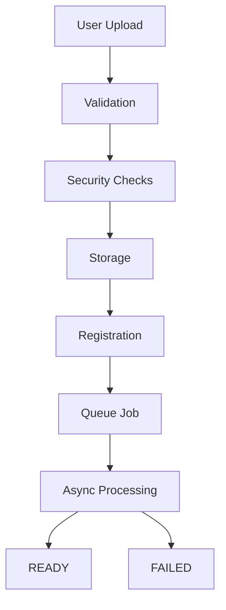
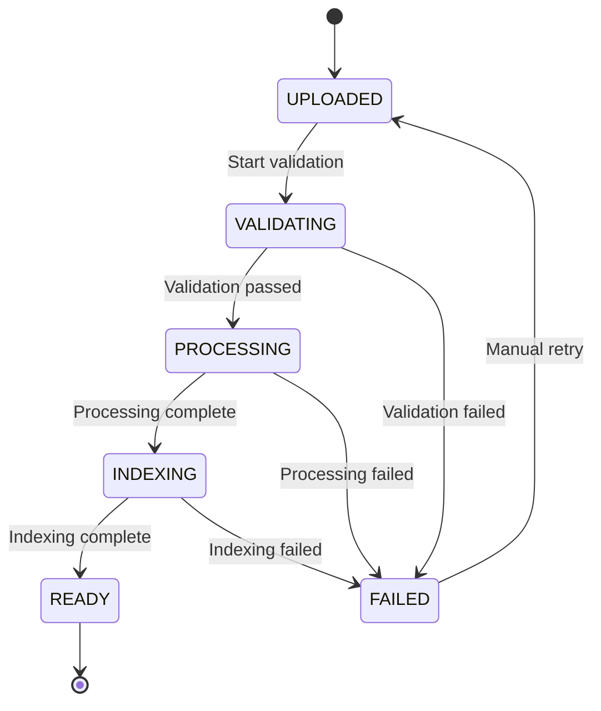

# Data Pipeline Specification

**Ask My Docs — Document Ingestion Subsystem**

---

# Supported Documents

## Formats

| Format | Extension | Parser | Notes |
|--------|-----------|--------|-------|
| PDF | .pdf | PyMuPDF | Primary format, OCR fallback |
| DOCX | .docx | python-docx | Structure preservation |
| Plain Text | .txt | Direct read | Encoding normalization |
| Markdown | .md | markdown parser | Structure preservation |
| HTML | .html | BeautifulSoup | Content extraction |

## Limits

| Parameter | Default | Configurable | Notes |
|-----------|---------|--------------|-------|
| Max file size | 50MB | Yes | Per upload |
| Max files per user | 100 | Yes | Per user per tenant |
| Max pages (PDF) | 500 | Yes | Excessive page limit |
| Max DOCX size | 20MB | Yes | DOCX specific |

---

# Upload Pipeline

## Flow



## Steps

### 1. Validation
- Validate file extension
- Validate MIME type
- Validate file size
- Validate file is not empty
- Validate file is not corrupted

### 2. Security Checks
- Verify MIME type matches extension
- Check for decompression bombs (PDF)
- Scan for malware (optional)
- Validate content is parseable

### 3. Storage
- Store original file in object storage
- Generate content hash for duplicate detection
- Store metadata: filename, size, mime_type, content_hash

### 4. Registration
- Create document record in PostgreSQL
- Set status: UPLOADED
- Record tenant_id, owner_id

### 5. Queue Job
- Enqueue ingestion task to Redis/Celery
- Include document_id and storage location
- Set retry configuration

---

# Parsing

## Parser Strategy

Each format has a dedicated parser that extracts:
- Text content
- Structure (headings, sections, paragraphs)
- Metadata (title, author, creation date)
- Page numbers (where applicable)

## PDF Parser

**Implementation:** PyMuPDF (fitz) or equivalent

**Capabilities:**
- Text extraction with position information
- Page number tracking
- Table detection (basic)
- Image detection (for OCR trigger)

**OCR Trigger:**
- When text extraction yields < configurable_threshold characters per page
- Default threshold: 100 characters per page
- Configurable: Yes

**OCR Provider:**
- Tesseract (local, free)
- Cloud OCR (configurable)
- Fallback: Skip OCR, process with available text

## DOCX Parser

**Implementation:** python-docx or equivalent

**Capabilities:**
- Paragraph extraction with style information
- Heading detection (Heading 1, 2, 3...)
- Table extraction
- List extraction
- Image detection

## TXT Parser

**Implementation:** Direct file reading

**Capabilities:**
- Encoding detection and normalization
- Line break normalization
- Whitespace preservation

## Markdown Parser

**Implementation:** markdown library or equivalent

**Capabilities:**
- Heading extraction
- List extraction
- Code block detection
- Link extraction
- Table extraction

## HTML Parser

**Implementation:** BeautifulSoup or equivalent

**Capabilities:**
- Content extraction (remove navigation, ads)
- Heading detection
- List extraction
- Table extraction
- Link extraction

---

# Cleaning

## Cleaning Rules

### Whitespace
- Normalize multiple spaces to single space
- Normalize multiple newlines to double newline
- Trim leading/trailing whitespace
- **Preserve:** Intentional formatting (code blocks, tables)

### Headers/Footers
- Detect repeated text at page boundaries
- Remove page numbers from header/footer regions
- **Preserve:** Meaningful headers (section titles)

### Encoding
- Normalize to UTF-8
- Handle BOM markers
- Fix mojibake (encoding errors)

### Duplicated Content
- Remove exact duplicate paragraphs
- **Preserve:** Intentional repetition (e.g., glossary definitions)

### Page Artifacts
- Remove PDF extraction artifacts
- Fix broken words across pages
- Remove watermark text (optional, configurable)

## What NOT to Destroy

- Section headings
- Paragraph breaks
- List items
- Table structures
- Code blocks
- Meaningful formatting

---

# Structure Detection

## Preserved Structure

### Title
- Document title from metadata
- First heading as fallback
- Filename as last resort

### Headings
- Heading hierarchy (H1, H2, H3...)
- Section boundaries
- Used for chunk context

### Sections
- Identified by headings
- Used for chunk grouping
- Used for citation metadata

### Paragraphs
- Natural text boundaries
- Used for chunk splitting

### Lists
- Ordered and unordered lists
- Preserved as complete units when possible

### Tables
- Detected and preserved
- Converted to structured text
- Used for context

### Page Numbers
- Tracked for citation metadata
- Used for page-level filtering

---

# Chunking

## Strategy Comparison

| Strategy | Pros | Cons | Recommendation |
|----------|------|------|----------------|
| Fixed-size | Simple, predictable | Breaks context, no structure awareness | Not recommended |
| Recursive | Respects structure, configurable | More complex | **Recommended** |
| Semantic | Best context preservation | Expensive, requires model | Future enhancement |

## Recursive Text Splitting (Recommended)

### Algorithm
1. Try to split on largest structure boundaries (sections)
2. If too large, split on paragraphs
3. If too large, split on sentences
4. If too large, split on words
5. If too large, split on characters (last resort)

### Configurable Parameters

| Parameter | Default | Configurable | Notes |
|-----------|---------|--------------|-------|
| chunk_size | 512 tokens | Yes | Target chunk size |
| chunk_overlap | 50 tokens | Yes | Overlap between chunks |
| min_chunk_size | 100 tokens | Yes | Minimum viable chunk |
| max_chunk_size | 1024 tokens | Yes | Maximum chunk size |
| separators | ["\n\n", "\n", ". ", " ", ""] | Yes | Split hierarchy |

## Chunk Structure

Each chunk contains:
- `chunk_id`: Unique identifier
- `document_id`: Parent document
- `chunk_index`: Position in document
- `content`: Chunk text
- `page_number`: Source page (if available)
- `section`: Source section (if available)
- `metadata`: Additional metadata

---

# Metadata

## Required Metadata

Every chunk must include:

| Field | Type | Description |
|-------|------|-------------|
| document_id | UUID | Parent document ID |
| chunk_id | UUID | Unique chunk identifier |
| tenant_id | UUID | Tenant isolation |
| filename | string | Human-readable filename |
| page_number | integer | Source page (nullable) |
| section | string | Source section (nullable) |
| content_hash | string | Chunk content hash |
| created_at | timestamp | Creation time |
| updated_at | timestamp | Last update time |

## Optional Metadata

| Field | Type | Description |
|-------|------|-------------|
| chunk_index | integer | Position in document |
| heading | string | Parent heading |
| mime_type | string | Document MIME type |
| embedding_model | string | Model used for embedding |
| embedding_version | string | Model version |

---

# Embeddings

## Abstraction

```python
# Conceptual interface
class EmbeddingProvider:
    def embed(self, texts: List[str]) -> List[List[float]]:
        """Embed list of texts into vectors."""
        pass

    def embed_query(self, query: str) -> List[float]:
        """Embed a single query."""
        pass

    @property
    def dimension(self) -> int:
        """Return embedding dimension."""
        pass
```

## Model Versioning

- Embedding model name and version stored in configuration
- Each chunk records embedding_model and embedding_version
- Re-embedding triggered on model change

## Dimension Compatibility

- Validate embedding dimension matches vector DB configuration
- Prevent dimension mismatch errors
- Log dimension mismatches

## Batch Processing

- Batch size configurable (default: 100)
- Rate limiting for API-based providers
- Error handling for batch failures

## Re-embedding Strategy

When embedding model changes:
1. Option A: Re-embed all chunks (comprehensive but expensive)
2. Option B: Re-embed on query only (cheaper but inconsistent)
3. Option C: Gradual re-embedding (background job)
- **Default:** Option C (configurable)

---

# Indexing

## PostgreSQL

### Document Storage
- Document metadata table
- Document chunk table
- Full-text search index (for BM25 fallback)

### Indexes
- Primary key on document_id
- Index on tenant_id (for isolation)
- Index on document_id (for document queries)
- Index on status (for status queries)

## Vector Database

### pgvector Setup
```sql
-- Create extension
CREATE EXTENSION IF NOT EXISTS vector;

-- Create table
CREATE TABLE document_chunks (
    id UUID PRIMARY KEY,
    tenant_id UUID NOT NULL,
    document_id UUID NOT NULL,
    chunk_index INTEGER NOT NULL,
    content TEXT NOT NULL,
    embedding VECTOR(1536)
);

-- Create indexes
CREATE INDEX ON document_chunks
    USING ivfflat (embedding vector_cosine_ops)
    WITH (lists = 100);

CREATE INDEX ON document_chunks (tenant_id);
CREATE INDEX ON document_chunks (document_id);
```

### Qdrant Setup (Alternative)
```json
{
  "collection_name": "document_chunks",
  "vector_size": 1536,
  "distance": "Cosine"
}
```

## BM25 Index

### PostgreSQL Full-Text Search
```sql
-- Add tsvector column
ALTER TABLE document_chunks
    ADD COLUMN search_vector tsvector;

-- Create GIN index
CREATE INDEX ON document_chunks
    USING GIN (search_vector);

-- Populate search vector
UPDATE document_chunks
SET search_vector = to_tsvector('english', content);
```

### Elasticsearch (Alternative)
- Dedicated BM25 index
- Custom tokenization
- Tenant-aware indexing

---

# Idempotency

## Duplicate Detection

### Content Hash
- SHA-256 hash of file content
- Stored with document metadata
- Checked before ingestion

### Duplicate Handling
- If duplicate detected:
  - Return existing document reference
  - Don't reprocess
  - Log duplicate detection
- Configurable: Enable/disable duplicate detection

## Reprocessing

### Triggers
- Manual reprocessing request
- Embedding model change
- Chunking parameter change

### Strategy
- Re-run full ingestion pipeline
- Replace existing chunks
- Update vector embeddings
- Update BM25 index

---

# Versioning

## Document Versioning

- Documents are immutable once uploaded
- New version = new document with same content_hash
- Version tracking via metadata
- Original document preserved

## Embedding Versioning

- Embedding model version tracked per chunk
- Query uses current embedding model
- Retrieval matches embedding version
- Re-embedding updates version

---

# Failure Handling

## Error Categories

### Retryable Errors
- Network timeouts
- Transient database errors
- Rate limiting (temporary)
- Service unavailable (temporary)

### Permanent Errors
- Invalid file format
- Corrupted document
- Parsing failure
- Embedding dimension mismatch

## Retry Strategy

- Exponential backoff
- Initial delay: 1 second
- Max delay: 60 seconds
- Max retries: 3 (configurable)
- Jitter: Yes (prevent thundering herd)

## Dead Letter Queue

- Failed tasks moved to DLQ after max retries
- DLQ tasks logged for investigation
- Manual retry option available
- DLQ monitoring and alerting

---

# Background Workers

## Worker Architecture

```
Redis Queue → Celery Worker → Ingestion Pipeline → Database/Vector DB
```

## Concurrency

- Worker concurrency configurable (default: 4)
- Per-tenant concurrency limits (optional)
- Resource-aware scaling

## Health Monitoring

- Worker heartbeat
- Task completion rate
- Failure rate tracking
- Queue depth monitoring

---

# Security

## Upload Security

### File Validation
- MIME type verification
- Extension validation
- File size limits
- Content scanning (optional)

### Storage Security
- Encrypted storage (at rest)
- Access-controlled storage
- No public URLs
- Signed URLs for temporary access

### Content Security
- Treat all content as untrusted
- Sanitize before storage
- No execution of embedded scripts
- Decompression bomb protection

---

# Observability

## Ingestion Metrics

- Documents uploaded (count)
- Documents processed (count)
- Documents failed (count)
- Processing time (histogram)
- Chunk count per document
- Embedding generation time
- Vector indexing time
- BM25 indexing time

## Logs

- Document upload events
- Parsing start/completion
- Chunking statistics
- Embedding generation
- Indexing operations
- Errors and failures

## Traces

- Full ingestion pipeline trace
- Individual stage timing
- Error attribution

---

# Data Integrity

## Conditions for READY Status

A document is marked READY when ALL of:
1. Parsing completed successfully
2. Chunking completed successfully
3. All chunks embedded successfully
4. All embeddings stored in vector DB
5. BM25 index updated
6. No errors in pipeline

## Atomicity

- Ingestion is all-or-nothing per document
- Partial ingestion rolled back
- Status reflects actual state
- No orphaned chunks

---

# Lifecycle

## Status Transitions



## Status Values

| Status | Description | User Visible |
|--------|-------------|--------------|
| UPLOADED | File uploaded, waiting processing | Yes |
| VALIDATING | Validation in progress | Yes |
| PROCESSING | Parsing/chunking/embedding | Yes |
| INDEXING | Vector/BM25 indexing | Yes |
| READY | Document ready for queries | Yes |
| FAILED | Processing failed | Yes (with error) |

---

# Acceptance Criteria

## Upload
- [ ] Upload accepts supported formats
- [ ] Upload rejects unsupported formats
- [ ] Upload respects file size limits
- [ ] Upload returns document ID
- [ ] Upload returns initial status

## Parsing
- [ ] PDF parsed correctly
- [ ] DOCX parsed with structure
- [ ] TXT parsed with encoding handling
- [ ] Markdown parsed with structure
- [ ] HTML parsed with content extraction
- [ ] OCR triggered appropriately

## Cleaning
- [ ] Whitespace normalized
- [ ] Headers/footers removed when detected
- [ ] Encoding normalized to UTF-8
- [ ] Meaningful structure preserved

## Chunking
- [ ] Chunks created with configurable size
- [ ] Overlap configured correctly
- [ ] Min/max chunk size enforced
- [ ] Chunks preserve document context

## Embeddings
- [ ] Embeddings generated for all chunks
- [ ] Dimension validation passes
- [ ] Batch processing works
- [ ] Provider abstraction functional

## Indexing
- [ ] Vectors stored in vector DB
- [ ] BM25 index updated
- [ ] Tenant filtering works
- [ ] Document filtering works

## Status
- [ ] Status transitions correctly
- [ ] READY only after all steps complete
- [ ] FAILED includes error message
- [ ] Status visible to users

## Failure Handling
- [ ] Retryable errors retried
- [ ] Permanent failures logged
- [ ] Dead letter queue works
- [ ] Failed documents isolated

---

*This document is consistent with ARCHITECTURE.md and RETRIEVAL.md.*
