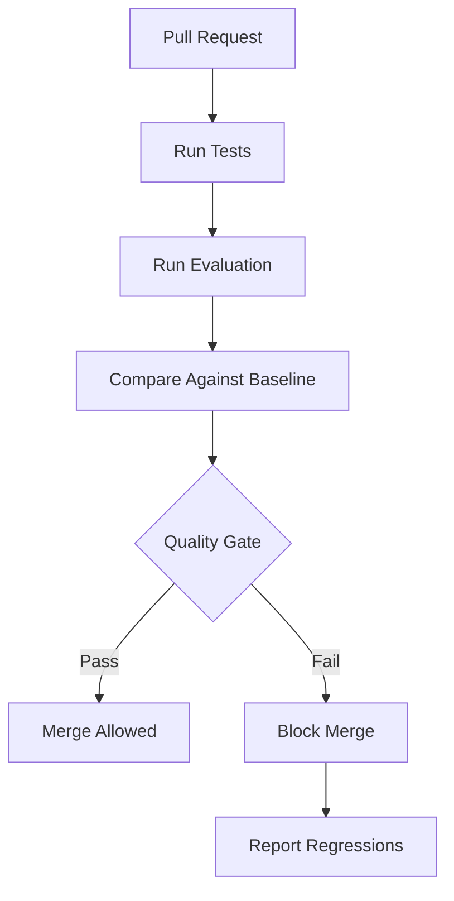
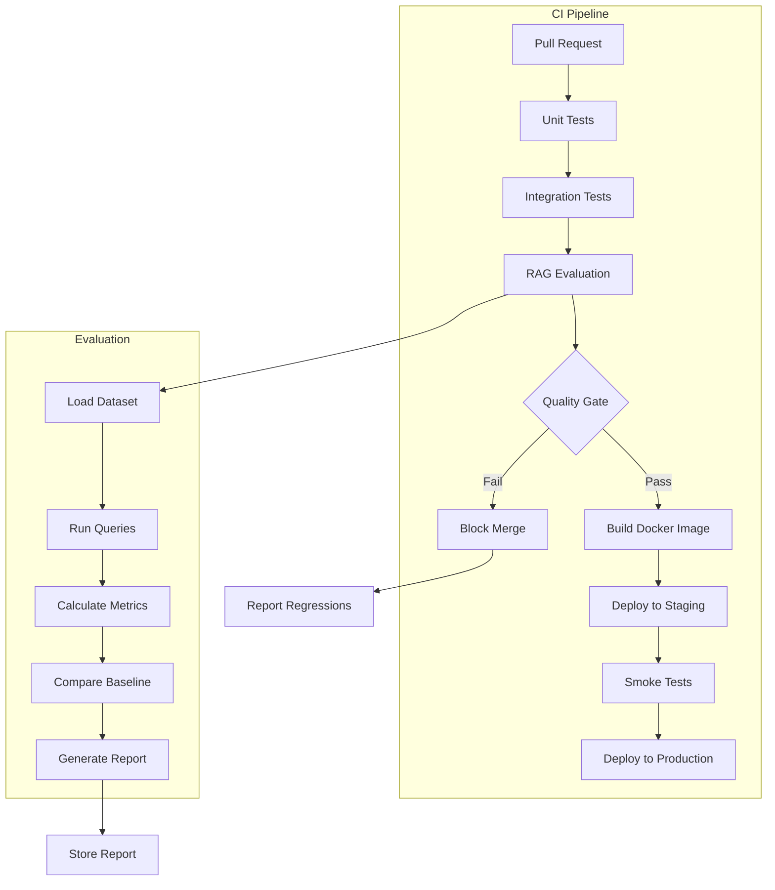

# Evaluation Specification

**Ask My Docs — RAG Evaluation Framework**

---

# Evaluation Philosophy

## Core Principles

1. **Separate Concerns**: Retrieval quality ≠ Generation quality
2. **Measure What Matters**: Focus on user-facing outcomes
3. **Automate Everything**: Manual evaluation doesn't scale
4. **Regression Detection**: Catch quality degradation early
5. **Reproducibility**: Evaluations must be deterministic
6. **Transparency**: All metrics and thresholds documented

## Quality Dimensions

```
Retrieval Quality → Context Quality → Generation Quality → Citation Quality
```

Each dimension measured independently, then combined for overall assessment.

---

# Golden Dataset

## Schema

```json
{
  "question_id": "q_001",
  "question": "What is the annual leave policy?",
  "expected_answer": "Employees receive 24 days of annual leave per calendar year.",
  "expected_documents": ["doc_abc123"],
  "expected_chunks": ["chunk_xyz789"],
  "expected_citations": [
    {
      "document_id": "doc_abc123",
      "chunk_id": "chunk_xyz789",
      "page": 42,
      "section": "Leave Policy"
    }
  ],
  "category": "factual",
  "difficulty": "easy",
  "notes": "Direct factual question with clear answer"
}
```

## Fields

| Field | Type | Required | Description |
|-------|------|----------|-------------|
| question_id | string | Yes | Unique identifier |
| question | string | Yes | User question |
| expected_answer | string | Yes | Ground truth answer |
| expected_documents | array[string] | Yes | Relevant document IDs |
| expected_chunks | array[string] | Yes | Relevant chunk IDs |
| expected_citations | array[object] | Yes | Expected citation metadata |
| category | string | Yes | Question category |
| difficulty | string | Yes | Question difficulty |
| notes | string | No | Additional context |

## Dataset Size

- **Minimum**: 50 questions per category
- **Recommended**: 200+ questions total
- **Coverage**: All question categories represented

---

# Retrieval Metrics

## Recall@K

**Definition**: Proportion of relevant chunks retrieved in top-K results.

**Formula**:
```
Recall@K = |relevant ∩ retrieved@K| / |relevant|
```

**Interpretation**:
- 1.0 = All relevant chunks retrieved
- 0.5 = Half of relevant chunks retrieved
- 0.0 = No relevant chunks retrieved

**Target**: Configurable (default: 0.7 at K=10)

**Use Case**: Measures completeness of retrieval.

## Precision@K

**Definition**: Proportion of retrieved chunks that are relevant.

**Formula**:
```
Precision@K = |relevant ∩ retrieved@K| / |retrieved@K|
```

**Interpretation**:
- 1.0 = All retrieved chunks are relevant
- 0.5 = Half of retrieved chunks are relevant
- 0.0 = No retrieved chunks are relevant

**Target**: Configurable (default: 0.5 at K=10)

**Use Case**: Measures accuracy of retrieval.

## MRR (Mean Reciprocal Rank)

**Definition**: Average of 1/rank of first relevant result.

**Formula**:
```
MRR = (1/Q) * Σ 1/rank_i
```

Where Q = number of queries, rank_i = rank of first relevant result for query i.

**Interpretation**:
- 1.0 = First result always relevant
- 0.5 = First relevant result at rank 2 on average
- 0.1 = First relevant result at rank 10 on average

**Target**: Configurable (default: 0.7)

**Use Case**: Measures ranking quality.

## NDCG (Normalized Discounted Cumulative Gain)

**Definition**: Quality of ranking considering position.

**Formula**:
```
NDCG@K = DCG@K / IDCG@K

DCG@K = Σ (2^rel_i - 1) / log2(i + 1)
IDCG@K = DCG@K of ideal ranking
```

**Interpretation**:
- 1.0 = Perfect ranking
- 0.5 = Half as good as perfect ranking
- 0.0 = Worst possible ranking

**Target**: Configurable (default: 0.7)

**Use Case**: Measures ranking quality with graded relevance.

---

# Generation Metrics

## Faithfulness

**Definition**: Answer is grounded in provided context.

**Measurement**:
- Compare answer claims against context
- Identify unsupported claims
- Calculate proportion of supported claims

**Formula**:
```
faithfulness = supported_claims / total_claims
```

**Target**: Configurable (default: 0.8)

**Use Case**: Detects hallucination.

## Answer Relevance

**Definition**: Answer addresses the question.

**Measurement**:
- Compare answer to question
- Measure topical overlap
- Assess completeness

**Formula**:
```
answer_relevance = relevance_score(question, answer)
```

**Target**: Configurable (default: 0.7)

**Use Case**: Measures answer quality.

## Context Relevance

**Definition**: Retrieved context is relevant to question.

**Measurement**:
- Compare context to question
- Measure topical overlap
- Assess informativeness

**Formula**:
```
context_relevance = relevance_score(question, context)
```

**Target**: Configurable (default: 0.7)

**Use Case**: Measures retrieval quality from generation perspective.

## Citation Correctness

**Definition**: Citations accurately reference source.

**Measurement**:
- Validate citation IDs against context
- Check citation metadata
- Verify citation-content alignment

**Formula**:
```
citation_correctness = correct_citations / total_citations
```

**Target**: Configurable (default: 0.9)

**Use Case**: Detects citation hallucination.

## Citation Completeness

**Definition**: All factual claims have citations.

**Measurement**:
- Identify factual claims in answer
- Check which claims have citations
- Calculate proportion cited

**Formula**:
```
citation_completeness = cited_claims / total_claims
```

**Target**: Configurable (default: 0.8)

**Use Case**: Ensures comprehensive citation.

---

# System Metrics

## Latency

### Percentiles
- **P50**: Median response time
- **P95**: 95th percentile response time
- **P99**: 99th percentile response time

### SLOs

| Metric | Target | Configurable |
|--------|--------|--------------|
| P50 | < 2000ms | Yes |
| P95 | < 5000ms | Yes |
| P99 | < 10000ms | Yes |

### Measurement
- Track latency per request
- Report percentiles
- Alert on SLO violations

## Token Usage

### Metrics
- **Prompt Tokens**: Input tokens to LLM
- **Completion Tokens**: Output tokens from LLM
- **Total Tokens**: Sum of prompt and completion

### Tracking
- Per-request token usage
- Aggregate token usage
- Cost estimation

## Cost/Query

### Calculation
```
cost_per_query = (prompt_tokens * prompt_price) + (completion_tokens * completion_price)
```

### Tracking
- Per-request cost
- Aggregate cost
- Cost trends

## Error Rate

### Formula
```
error_rate = failed_requests / total_requests
```

### SLOs

| Metric | Target | Configurable |
|--------|--------|--------------|
| Error rate | < 1% | Yes |

---

# Dataset Categories

## Factual

- Direct factual questions
- Single answer expected
- Clear source document

**Example**: "What is the annual leave policy?"

## Semantic

- Questions requiring understanding
- Multiple valid phrasings
- Conceptual answers

**Example**: "How does the company support work-life balance?"

## Exact-Match

- Questions with specific answers
- Numbers, dates, names
- Verifiable facts

**Example**: "How many vacation days do employees get?"

## Multi-Hop

- Questions requiring multiple sources
- Information from different documents
- Reasoning across facts

**Example**: "What benefits are available to employees with more than 5 years of service?"

## Ambiguous

- Questions with multiple interpretations
- Requires disambiguation
- May need clarification

**Example**: "What is the policy?" (which policy?)

## No-Answer

- Questions with no answer in corpus
- System should refuse to answer
- Tests no-answer behavior

**Example**: "What is the company's stock price?" (if not in documents)

## Long-Context

- Questions requiring extensive context
- Multiple chunks needed
- Tests context window management

**Example**: "Summarize all HR policies mentioned in the handbook."

## Citation-Heavy

- Questions requiring multiple citations
- Tests citation completeness
- Tests citation accuracy

**Example**: "Compare the leave policies across all departments."

---

# Baseline

## Methodology

1. **Run evaluation** on golden dataset
2. **Record metrics** for all dimensions
3. **Store as baseline** with version tag
4. **Compare subsequent runs** against baseline

## Baseline Storage

```json
{
  "baseline_id": "baseline_v1",
  "created_at": "2025-01-15T10:30:00Z",
  "dataset_version": "v1.0",
  "config": {
    "embedding_model": "text-embedding-ada-002",
    "reranker_model": "cross-encoder/ms-marco-MiniLM-L-6-v2",
    "vector_top_k": 30,
    "bm25_top_k": 30,
    "reranker_top_k": 5
  },
  "metrics": {
    "retrieval": {
      "recall_at_10": 0.72,
      "precision_at_10": 0.55,
      "mrr": 0.68,
      "ndcg_at_10": 0.71
    },
    "generation": {
      "faithfulness": 0.83,
      "answer_relevance": 0.75,
      "context_relevance": 0.72,
      "citation_correctness": 0.91,
      "citation_completeness": 0.82
    },
    "system": {
      "p50_latency_ms": 1800,
      "p95_latency_ms": 4200,
      "p99_latency_ms": 8500,
      "error_rate": 0.005
    }
  }
}
```

---

# Regression Detection

## Process

1. **Run new evaluation** with current configuration
2. **Compare against baseline** metrics
3. **Check thresholds** for each metric
4. **Flag regressions** where metrics drop below thresholds
5. **Generate report** with regression details

## Comparison Logic

```python
def check_regression(new_metrics, baseline_metrics, thresholds):
    regressions = []
    for metric, new_value in new_metrics.items():
        baseline_value = baseline_metrics[metric]
        threshold = thresholds[metric]
        if new_value < baseline_value - threshold:
            regressions.append({
                "metric": metric,
                "baseline": baseline_value,
                "current": new_value,
                "threshold": threshold,
                "regression": baseline_value - new_value
            })
    return regressions
```

## Thresholds

```yaml
retrieval:
  recall_at_10:
    absolute_threshold: 0.05  # Max drop from baseline
    minimum_value: 0.6  # Absolute minimum
  precision_at_10:
    absolute_threshold: 0.05
    minimum_value: 0.4
  mrr:
    absolute_threshold: 0.05
    minimum_value: 0.6
  ndcg_at_10:
    absolute_threshold: 0.05
    minimum_value: 0.6
generation:
  faithfulness:
    absolute_threshold: 0.05
    minimum_value: 0.7
  answer_relevance:
    absolute_threshold: 0.05
    minimum_value: 0.6
  context_relevance:
    absolute_threshold: 0.05
    minimum_value: 0.6
  citation_correctness:
    absolute_threshold: 0.05
    minimum_value: 0.8
  citation_completeness:
    absolute_threshold: 0.05
    minimum_value: 0.7
system:
  p95_latency_ms:
    absolute_threshold: 1000  # Max increase
    maximum_value: 6000  # Absolute maximum
  error_rate:
    absolute_threshold: 0.005  # Max increase
    maximum_value: 0.02  # Absolute maximum
```

---

# CI Quality Gates

## Workflow



## Quality Gate Rules

### Block Deployment If:
- Any metric drops below absolute minimum
- Any metric regresses more than threshold from baseline
- Error rate exceeds maximum
- Latency exceeds maximum

### Allow Deployment If:
- All metrics above minimums
- No regressions beyond thresholds
- Error rate within limits
- Latency within limits

## CI Configuration

```yaml
evaluation:
  enabled: true
  dataset: "evaluation/golden_dataset.json"
  baseline: "evaluation/baseline.json"
  thresholds: "evaluation/thresholds.yaml"
  timeout_minutes: 30
  fail_on_regression: true
```

---

# Reports

## Evaluation Report Schema

```json
{
  "report_id": "eval_20250115_103000",
  "run_id": "run_abc123",
  "dataset_version": "v1.0",
  "config_version": "v2.1",
  "timestamp": "2025-01-15T10:30:00Z",
  "duration_seconds": 1200,
  "metrics": {
    "retrieval": {...},
    "generation": {...},
    "system": {...}
  },
  "baseline_comparison": {
    "improved": ["recall_at_10"],
    "regressed": ["faithfulness"],
    "unchanged": ["precision_at_10"]
  },
  "quality_gate": {
    "passed": false,
    "failures": [
      {
        "metric": "faithfulness",
        "baseline": 0.83,
        "current": 0.76,
        "threshold": 0.05
      }
    ]
  },
  "per_question_results": [...]
}
```

## Report Access

- Store reports in evaluation database
- Link to CI/CD runs
- Accessible via API (future)

---

# Experiment Tracking

## Tracked Parameters

### Model Versions
- `embedding_model`: Model used for embeddings
- `embedding_version`: Model version
- `reranker_model`: Model used for reranking
- `reranker_version`: Model version
- `llm_model`: Model used for generation
- `llm_version`: Model version

### Retrieval Configuration
- `vector_top_k`: Vector search top-K
- `bm25_top_k`: BM25 search top-K
- `fusion_method`: Fusion algorithm
- `fusion_alpha`: Weighted fusion alpha
- `rrf_k`: RRF constant
- `reranker_top_k`: Final reranked top-K

### Prompt Version
- `system_prompt_version`: System prompt version
- `citation_prompt_version`: Citation instruction version

### Dataset Version
- `dataset_version`: Golden dataset version
- `dataset_size`: Number of questions

## Experiment Record

```json
{
  "experiment_id": "exp_abc123",
  "name": "Increased vector_top_k to 50",
  "description": "Testing impact of retrieving more candidates",
  "timestamp": "2025-01-15T10:30:00Z",
  "parameters": {
    "embedding_model": "text-embedding-ada-002",
    "vector_top_k": 50,
    "bm25_top_k": 30,
    "reranker_top_k": 5
  },
  "results": {
    "recall_at_10": 0.75,
    "precision_at_10": 0.52,
    "faithfulness": 0.85
  },
  "comparison": {
    "baseline_recall_at_10": 0.72,
    "baseline_precision_at_10": 0.55
  },
  "conclusion": "Recall improved but precision decreased slightly"
}
```

---

# Failure Analysis

## Debugging Workflow

1. **Identify failing metric** from evaluation report
2. **Examine per-question results** for that metric
3. **Identify patterns** in failures
4. **Inspect retrieval results** for failing questions
5. **Inspect generation output** for failing questions
6. **Adjust configuration** or prompts
7. **Re-evaluate** to confirm fix

## Common Failure Patterns

### Low Recall
- **Cause**: Retrieval missing relevant chunks
- **Fix**: Increase top-K, improve embedding model, add query expansion

### Low Precision
- **Cause**: Too many irrelevant chunks retrieved
- **Fix**: Decrease top-K, improve reranking, better filtering

### Low Faithfulness
- **Cause**: LLM not using context
- **Fix**: Improve prompts, check context quality, adjust temperature

### Low Citation Correctness
- **Cause**: LLM inventing citations
- **Fix**: Improve citation prompts, add validation, check context format

---

# Human Evaluation

## When Required

- New evaluation dataset creation
- Ambiguous questions in dataset
- Low automated metric scores
- Major prompt changes
- New model evaluation

## Process

1. **Sample questions** from evaluation set
2. **Human annotators** rate answers
3. **Calculate agreement** (inter-annotator kappa)
4. **Compare** with automated metrics
5. **Calibrate** automated metrics if needed

## Annotation Schema

```json
{
  "question_id": "q_001",
  "answer_quality": 4,  // 1-5 scale
  "citation_accuracy": 5,  // 1-5 scale
  "completeness": 4,  // 1-5 scale
  "notes": "Answer is accurate and well-cited"
}
```

---

# Reproducibility

## Requirements

1. **Fixed Dataset**: Golden dataset versioned
2. **Fixed Configuration**: All parameters documented
3. **Fixed Models**: Model versions pinned
4. **Deterministic**: Same input → same output (where possible)
5. **Environment**: Same dependencies and versions

## Reproducibility Checklist

- [ ] Dataset version documented
- [ ] Configuration version documented
- [ ] Model versions documented
- [ ] Random seeds fixed (where applicable)
- [ ] Environment documented

---

# Acceptance Criteria

## Evaluation System

- [ ] Golden dataset loads successfully
- [ ] Retrieval metrics calculated correctly
- [ ] Generation metrics calculated correctly
- [ ] System metrics collected
- [ ] Baseline comparison works
- [ ] Regression detection works
- [ ] CI quality gates block on regression
- [ ] Evaluation reports generated
- [ ] Experiment tracking works

## Metric Accuracy

- [ ] Recall@K matches manual calculation
- [ ] Precision@K matches manual calculation
- [ ] MRR matches manual calculation
- [ ] NDCG matches manual calculation
- [ ] Faithfulness scoring validated
- [ ] Citation metrics validated

## CI Integration

- [ ] Evaluation runs on pull requests
- [ ] Quality gates block merge on regression
- [ ] Reports accessible in CI
- [ ] Regressions clearly reported

---

# CI Evaluation Diagram



---

*This document is consistent with RETRIEVAL.md, docs/citations.md, and CI requirements in REQUIREMENTS.md.*
