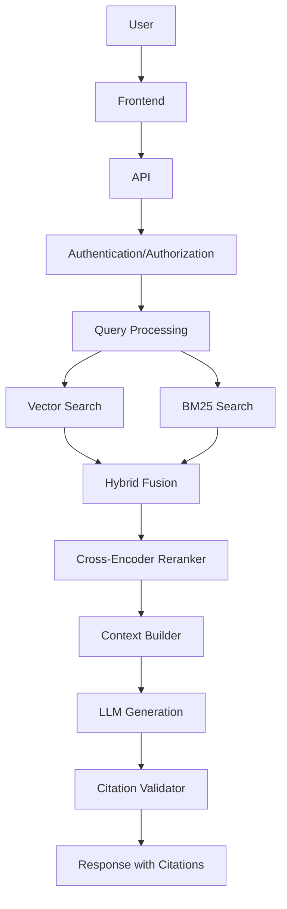

# Ask My Docs

**Production-Grade Enterprise RAG Application**

A domain-specific retrieval-augmented generation system where authenticated users upload documents and ask natural-language questions with verifiable citations.

---

## Overview

Ask My Docs implements a production-grade enterprise RAG architecture designed for real-world document question-answering. Unlike simple "chat with PDF" tools, this system provides:

- **Hybrid retrieval** combining vector search and BM25
- **Cross-encoder reranking** for precision
- **Citation enforcement** with validation
- **Multi-tenant isolation** with document-level access control
- **Evaluation-driven development** with CI quality gates
- **Production observability** with metrics and tracing

## Key Features

- **Hybrid Retrieval**: Vector similarity + BM25 keyword search with configurable fusion
- **Cross-Encoder Reranking**: Precision retrieval through learned reranking
- **Citation Enforcement**: Every factual claim traced to retrieved evidence
- **Evaluation Framework**: Automated RAG quality measurement
- **CI Quality Gates**: Regression detection blocks deployment
- **Authentication & RBAC**: JWT-based auth with role-based access control
- **Multi-Tenancy**: Strict tenant isolation at database and retrieval layers
- **Document-Level Access Control**: Fine-grained permission enforcement
- **Observability**: Metrics, tracing, and retrieval inspection
- **Provider Abstraction**: Configurable embedding, reranking, and LLM providers
- **Background Processing**: Async document ingestion with retry handling

## Why This Project

Basic "chat with PDF" systems fail in production because they:
- Cannot handle multiple documents across users
- Lack authorization (any user can access any document)
- Produce hallucinated citations without validation
- Have no quality measurement or regression detection
- Cannot scale beyond prototype deployments

Ask My Docs solves these problems with enterprise-grade architecture while remaining practical for incremental development.

## Architecture



## RAG Pipeline

### Ingestion Pipeline
```
Document Upload → Validation → Security Checks → Storage → Parsing →
Cleaning → Structure Detection → Chunking → Metadata Extraction →
Embedding → Vector Indexing → BM25 Indexing → READY
```

### Query Pipeline
```
User Query → Query Processing → Metadata Filtering →
Vector Search + BM25 → Hybrid Fusion → Cross-Encoder Reranking →
Context Construction → LLM Generation → Citation Validation →
Grounded Answer with Citations
```

## Citation System

Every document-grounded factual claim includes traceable citations:

```json
{
  "answer": "Employees receive 24 days of annual leave.[1]",
  "citations": [
    {
      "citation_id": 1,
      "document_id": "doc_abc123",
      "chunk_id": "chunk_xyz789",
      "filename": "Employee Handbook.pdf",
      "page": 42,
      "section": "Leave Policy",
      "snippet": "Annual leave entitlement is 24 days per calendar year..."
    }
  ]
}
```

## Technology Stack

| Component | Technology | Rationale |
|-----------|-----------|-----------|
| Backend | Python + FastAPI | Async support, type safety, performance |
| Database | PostgreSQL | Relational integrity, JSON support, extensions |
| Vector DB | pgvector or Qdrant | Production-ready, filtering support |
| Search | BM25 (Elasticsearch/SQLite) | Keyword retrieval |
| Cache/Queue | Redis | Celery broker, caching, rate limiting |
| Workers | Celery | Background task processing |
| LLM | Provider abstraction | Configurable model selection |
| Embeddings | Provider abstraction | Configurable model selection |
| Reranker | Cross-encoder | Precision retrieval |
| Frontend | React | Interactive UI |
| Containers | Docker | Consistent deployment |
| CI | GitHub Actions | Automation, quality gates |
| Observability | OpenTelemetry + Langfuse | Metrics, tracing, evaluation |

## Project Structure

```
ask-my-docs/
├── src/
│   ├── api/                 # FastAPI routes and middleware
│   ├── auth/                # Authentication and authorization
│   ├── documents/           # Document management
│   ├── ingestion/           # Document processing pipeline
│   ├── retrieval/           # Retrieval subsystem
│   ├── generation/          # LLM generation and citations
│   ├── evaluation/          # RAG evaluation framework
│   └── infrastructure/      # Database, cache, queue clients
├── workers/                 # Celery background workers
├── frontend/                # React application
├── tests/                   # Test suites
├── evaluation/              # Golden datasets and evaluation configs
├── docker/                  # Docker configurations
└── docs/                    # Documentation
```

## Development Phases

1. **Phase 0 - Design**: Documentation and architecture (current)
2. **Phase 1 - Ingestion**: Document processing pipeline
3. **Phase 2 - Retrieval**: Vector search, BM25, hybrid fusion, reranking
4. **Phase 3 - API**: FastAPI endpoints and authentication
5. **Phase 4 - Citations**: Citation enforcement and validation
6. **Phase 5 - Evaluation**: RAG quality measurement and CI gates
7. **Phase 6 - Security**: Security hardening and testing
8. **Phase 7 - Deployment**: Production deployment infrastructure

## Evaluation

RAG quality is measured across:
- **Retrieval**: Recall@K, Precision@K, MRR, NDCG
- **Generation**: Faithfulness, answer relevance, context relevance
- **Citations**: Correctness, completeness, relevance
- **System**: Latency, cost, error rates

## CI Quality Gates

Pull requests trigger evaluation against golden datasets. Deployment is blocked if:
- Retrieval recall drops below configurable threshold
- Faithfulness score regresses
- Citation accuracy decreases

## Security

- JWT authentication with refresh tokens
- Role-based access control (Admin, User)
- Multi-tenant data isolation
- Document-level permissions
- Input validation and sanitization
- Rate limiting
- Secure credential management

## Local Development

### Prerequisites
- Python 3.11+
- Docker and Docker Compose
- PostgreSQL
- Redis

### Setup
```bash
# Clone the repository
git clone <repository-url>

# Start infrastructure
docker-compose up -d

# Install dependencies
pip install -e ".[dev]"

# Run database migrations
alembic upgrade head

# Start development servers
uvicorn src.api.main:app --reload
celery -A workers.celery_app worker --loglevel=info
```

## Production Readiness

- [ ] Authentication and authorization
- [ ] Multi-tenant isolation
- [ ] Document access control
- [ ] Input validation
- [ ] Rate limiting
- [ ] Health checks
- [ ] Metrics and monitoring
- [ ] Logging and tracing
- [ ] Error handling
- [ ] Background workers
- [ ] Database migrations
- [ ] Backup procedures
- [ ] Security testing
- [ ] Evaluation framework
- [ ] CI quality gates

## Roadmap

See [ROADMAP.md](ROADMAP.md) for detailed phase planning.

---

**Status**: Design Phase - Documentation in progress

**This project is not yet implemented.** All documents are specifications for future implementation.
