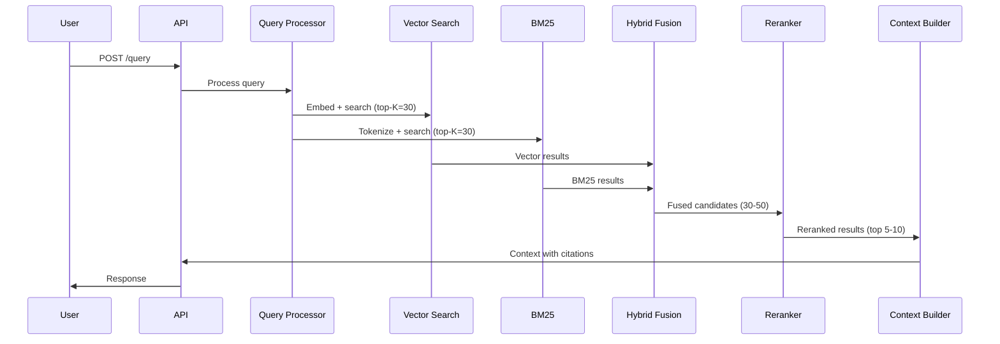

# Retrieval Specification

**Ask My Docs — Retrieval Subsystem**

---

# Retrieval Goals

1. **Relevance**: Retrieve chunks most relevant to the user's question
2. **Recall**: Ensure relevant chunks are not missed
3. **Precision**: Minimize irrelevant chunks in results
4. **Freshness**: Prioritize recent documents when configured
5. **Security**: Enforce tenant isolation and document permissions
6. **Performance**: Meet latency SLOs while maintaining quality
7. **Observability**: Enable inspection of retrieval behavior

---

# Query Processing

## Normalization

- Trim whitespace
- Normalize Unicode characters
- Handle encoding issues
- Remove control characters

## Query Rewriting (Optional)

### Configuration
- `enable_query_rewriting`: false (default)
- `rewriting_strategy`: "expansion" | "decomposition"

### Expansion
- Add synonyms for key terms
- Expand acronyms
- Add related terms

### Decomposition
- Break complex questions into sub-questions
- Retrieve for each sub-question
- Combine results

## Metadata Extraction

- Extract mentioned document names (if any)
- Extract mentioned dates (if any)
- Extract mentioned people (if any)
- Use for optional metadata filtering

## Filtering

### Mandatory Filters
- `tenant_id`: Always applied (from authenticated user)

### Optional Filters
- `document_ids`: Filter to specific documents
- `user_permissions`: Filter to authorized documents
- `date_range`: Filter by document date (if metadata available)

---

# Vector Search

## Process

```
Query → Embed → Vector Database → Similarity Search → Filter → Results
```

## Embedding

- Embed query using configured embedding provider
- Use same model as document embedding
- Validate dimension compatibility

## Similarity

- Cosine similarity (recommended)
- Alternative: Dot product, Euclidean distance
- Configurable: Yes

## Top-K

- `vector_top_k`: 30 (default, configurable)
- Higher values improve recall but increase latency
- Lower values improve latency but may reduce recall

## Filtering

```sql
-- pgvector example
SELECT id, content, metadata, embedding <=> $1 as score
FROM document_chunks
WHERE tenant_id = $2
  AND ($3::uuid[] IS NULL OR document_id = ANY($3))
ORDER BY embedding <=> $1
LIMIT $4;
```

```json
// Qdrant example
{
  "filter": {
    "must": [
      {"key": "tenant_id", "match": {"value": "tenant-uuid"}},
      {"key": "document_id", "match": {"any": ["doc1", "doc2"]}}
    ]
  },
  "limit": 30
}
```

## Scores

- Return similarity score for each result
- Score range: 0 to 1 (cosine similarity)
- Higher score = more similar

---

# BM25

## Indexing

- Tokenize document chunks
- Build inverted index
- Store term frequencies and document frequencies

## Tokenization

### Configuration
- `stemming`: true (default)
- `stop_words`: "english" (default)
- `min_token_length`: 2 (default)
- `tokenizer`: "standard" (default)

### Options
- Standard tokenizer (whitespace + punctuation)
- Custom tokenizer (configurable rules)
- Language-specific tokenization

## Ranking

### BM25 Formula
```
score(D, Q) = Σ IDF(qi) * (f(qi, D) * (k1 + 1)) / (f(qi, D) + k1 * (1 - b + b * |D| / avgdl))
```

### Parameters
- `k1`: 1.5 (default, term frequency saturation)
- `b`: 0.75 (default, length normalization)
- Both configurable

## Top-K

- `bm25_top_k`: 30 (default, configurable)
- Same trade-offs as vector search

## Filtering

- Apply tenant_id filter
- Apply document_id filter (if specified)
- Apply user permission filter

---

# Hybrid Retrieval

## Comparison

| Method | Pros | Cons | Recommendation |
|--------|------|------|----------------|
| Weighted Fusion | Simple, interpretable | Requires score normalization | Alternative |
| Reciprocal Rank Fusion | No normalization needed, robust | Less interpretable | **Recommended** |

## Reciprocal Rank Fusion (Recommended)

### Formula
```
RRF_score(d) = Σ 1 / (k + rank_i(d))
```

- `k`: Constant to reduce impact of high-ranked documents (default: 60)
- `rank_i(d)`: Rank of document d in result list i
- Higher score = more relevant across multiple retrievers

### Configuration
- `fusion_method`: "rrf" (default)
- `rrf_k`: 60 (default, configurable)

## Weighted Fusion (Alternative)

### Formula
```
final_score = α * vector_score + (1-α) * bm25_score
```

- `α`: Weight for vector score (default: 0.7)
- Requires score normalization (min-max or z-score)

### Configuration
- `fusion_method`: "weighted"
- `fusion_alpha`: 0.7 (default, configurable)

## Candidate Retrieval

### Configuration
- `vector_top_k`: 30 (default)
- `bm25_top_k`: 30 (default)
- `fusion_candidates`: 30-50 (default range)

### Process
1. Retrieve top-K from vector search
2. Retrieve top-K from BM25
3. Combine and deduplicate
4. Apply fusion algorithm
5. Return top fusion_candidates

---

# Cross-Encoder Reranking

## Process

```
Fused Candidates → Cross-Encoder → Scored Results → Top-K (final_K)
```

## Cross-Encoder

### How It Works
- Input: (query, chunk) pair
- Output: Relevance score (0 to 1)
- More accurate than bi-encoder but slower
- Applied to candidate set, not full corpus

### Configuration
- `reranker_model`: "cross-encoder/ms-marco-MiniLM-L-6-v2" (default, configurable)
- `reranker_provider`: "sentence-transformers" | "api" (configurable)

## Final-K

- `reranker_top_k`: 5-10 (default, configurable)
- Smaller than fusion_candidates
- Balances precision and context window

## Fallback

- If reranker fails: Use fusion ranking
- If reranker times out: Use fusion ranking
- Log fallback for monitoring

## Score Tracking

- Log reranker scores for each chunk
- Use for evaluation and debugging
- Track score distribution

---

# Deduplication

## Duplicate Detection

### Exact Duplicates
- Same content hash
- Remove duplicates, keep highest-scored

### Near-Duplicates
- Cosine similarity > threshold (configurable)
- Default threshold: 0.95
- Remove near-duplicates, keep highest-scored

## Configuration

- `deduplication_enabled`: true (default)
- `deduplication_threshold`: 0.95 (default, configurable)

---

# Context Construction

## Ordering

- Order by reranker score (descending)
- Highest-scored chunks first

## Token Budget

- `context_token_budget`: 4096 (default, configurable)
- Include chunks until budget exhausted
- Partial chunks allowed (truncated)

## Citation Metadata

For each chunk in context:
```json
{
  "citation_id": 1,
  "document_id": "doc_abc123",
  "chunk_id": "chunk_xyz789",
  "filename": "Employee Handbook.pdf",
  "page": 42,
  "section": "Leave Policy",
  "snippet": "Annual leave entitlement is 24 days..."
}
```

## Truncation

- If context exceeds token budget:
  - Truncate lowest-scored chunks
  - Truncate within chunks if needed
  - Preserve citation metadata

## Formatting

```
[Citation 1] (Employee Handbook.pdf, Page 42, Section: Leave Policy)
Annual leave entitlement is 24 days per calendar year...

[Citation 2] (Benefits Guide.pdf, Page 15, Section: Health Insurance)
Health insurance coverage begins on the first day of employment...
```

---

# Metadata Filtering

## Mandatory Filters

### Tenant Isolation
```sql
WHERE tenant_id = $1
```
- Always applied
- Cannot be bypassed
- Enforced at database level

## Optional Filters

### Document Filtering
```sql
WHERE document_id = ANY($2)
```
- Filter to specific documents
- Used for conversation context

### User Permission Filtering
```sql
WHERE document_id IN (
    SELECT document_id FROM document_permissions
    WHERE user_id = $1 OR is_public = true
)
```
- Filter to authorized documents
- Checked before retrieval

---

# No-Answer Behavior

## When to Refuse

- No chunks retrieved (all scores below threshold)
- Retrieved chunks not relevant to query
- Query is opinion-based (not factual)
- Query requires real-time information

## Configuration

- `no_answer_threshold`: 0.3 (default, configurable)
- If max retrieval score < threshold: No answer
- If max reranker score < threshold: No answer

## Response Format

```json
{
  "answer": "I don't have enough information in the provided documents to answer this question.",
  "citations": [],
  "confidence": "low"
}
```

---

# Retrieval Confidence

## Evidence-Based Signals

### High Confidence
- Multiple chunks with high similarity scores
- Reranker scores consistent with vector/BM25 scores
- Citations span multiple documents

### Medium Confidence
- Some chunks with moderate scores
- Reranker scores mixed
- Citations from single document

### Low Confidence
- Low similarity scores
- Reranker scores low
- No or weak citations

## Configuration

- `confidence_thresholds`:
  - high: 0.7 (configurable)
  - medium: 0.5 (configurable)
  - low: 0.3 (configurable)

---

# Evaluation

## Retrieval Metrics

### Recall@K
- **Definition**: Proportion of relevant chunks in top-K results
- **Formula**: |relevant ∩ retrieved| / |relevant|
- **Target**: Configurable (default: 0.7 at K=10)

### Precision@K
- **Definition**: Proportion of retrieved chunks that are relevant
- **Formula**: |relevant ∩ retrieved| / |retrieved|
- **Target**: Configurable (default: 0.5 at K=10)

### MRR (Mean Reciprocal Rank)
- **Definition**: Average of 1/rank of first relevant result
- **Formula**: (1/Q) * Σ 1/rank_i
- **Target**: Configurable (default: 0.7)

### NDCG (Normalized Discounted Cumulative Gain)
- **Definition**: Quality of ranking considering position
- **Formula**: DCG / IDCG
- **Target**: Configurable (default: 0.7)

---

# Latency

## SLO Targets

| Metric | Target | Configurable |
|--------|--------|--------------|
| Vector search | < 100ms | Yes |
| BM25 search | < 50ms | Yes |
| Fusion | < 10ms | Yes |
| Reranking | < 200ms | Yes |
| Total retrieval | < 500ms | Yes |

## Measurement

- Track latency per stage
- Report P50, P95, P99
- Alert on SLO violations

---

# Failure Handling

## Vector DB Failure

- **Behavior**: Skip vector search, use BM25 only
- **Logging**: Log error and fallback
- **User Impact**: Reduced retrieval quality

## BM25 Failure

- **Behavior**: Skip BM25, use vector search only
- **Logging**: Log error and fallback
- **User Impact**: Reduced retrieval quality

## Reranker Failure

- **Behavior**: Use fusion ranking
- **Logging**: Log error and fallback
- **User Impact**: Slightly reduced precision

## Embedding Failure (Query)

- **Behavior**: Return error
- **Logging**: Log error
- **User Impact**: Unable to answer

## Complete Failure

- **Behavior**: Return no-answer response
- **Logging**: Log error
- **User Impact**: No answer

---

# Observability

## Tracked Metrics

### Retrieval Scores
- Vector similarity scores distribution
- BM25 scores distribution
- Fusion scores distribution
- Reranker scores distribution

### Latency
- Per-stage latency
- Total retrieval latency
- P50, P95, P99

### Quality
- Retrieval recall (when ground truth available)
- Reranker score correlation with relevance

### Errors
- Vector DB errors
- BM25 errors
- Reranker errors
- Fallback frequency

## Logging

- Query text
- Retrieved chunks with scores
- Reranker scores
- Final context
- Latency per stage

## Tracing

- Full retrieval pipeline trace
- Individual stage timing
- Error attribution

---

# Acceptance Tests

## Test Cases

### Basic Retrieval
- [ ] Query returns relevant chunks
- [ ] Results ordered by relevance
- [ ] Tenant isolation enforced
- [ ] Document permissions enforced

### Hybrid Fusion
- [ ] Fusion improves over individual methods
- [ ] RRF parameters configurable
- [ ] Weighted fusion alternative works

### Reranking
- [ ] Reranking improves precision
- [ ] Fallback works on failure
- [ ] Final-K respected

### No-Answer
- [ ] No-answer for irrelevant queries
- [ ] No-answer for empty corpus
- [ ] Clear messaging

### Failure Handling
- [ ] Vector DB failure fallback
- [ ] BM25 failure fallback
- [ ] Reranker failure fallback

### Performance
- [ ] Vector search < 100ms
- [ ] BM25 search < 50ms
- [ ] Reranking < 200ms
- [ ] Total < 500ms

---

# Sequence Diagram



---

*This document is consistent with ARCHITECTURE.md, DATA_PIPELINE.md, and docs/citations.md.*
