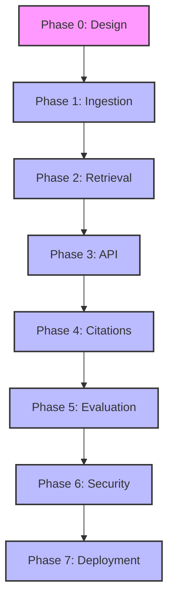

# Roadmap

**Ask My Docs — Production RAG Application**

---

# Overview

This roadmap defines the implementation phases for Ask My Docs. Each phase builds on previous phases and includes tasks, dependencies, deliverables, tests, documentation, acceptance criteria, and exit criteria.

**Status Legend:**
- [ ] Planned
- [x] Completed (none - project not yet implemented)

---

# Phase 0 — Design

**Objective:** Complete technical specification and architecture documentation.

**Dependencies:** None

## Tasks

- [ ] Review and finalize REQUIREMENTS.md
- [ ] Review and finalize ARCHITECTURE.md
- [ ] Review and finalize DATA_PIPELINE.md
- [ ] Review and finalize RETRIEVAL.md
- [ ] Review and finalize API.md
- [ ] Review and finalize docs/citations.md
- [ ] Review and finalize EVALUATION.md
- [ ] Review and finalize SECURITY.md
- [ ] Review and finalize DEPLOYMENT.md
- [ ] Review and finalize ROADMAP.md
- [ ] Review and finalize README.md
- [ ] Cross-document consistency review
- [ ] Stakeholder approval

## Deliverables

- [ ] REQUIREMENTS.md (source of truth)
- [ ] ARCHITECTURE.md (component design)
- [ ] DATA_PIPELINE.md (ingestion specification)
- [ ] RETRIEVAL.md (retrieval specification)
- [ ] API.md (REST API specification)
- [ ] docs/citations.md (citation specification)
- [ ] EVALUATION.md (evaluation framework)
- [ ] SECURITY.md (security architecture)
- [ ] DEPLOYMENT.md (deployment architecture)
- [ ] ROADMAP.md (this document)
- [ ] README.md (project overview)

## Tests

- [ ] Documentation completeness checklist passed
- [ ] No contradictions between documents
- [ ] All configurable parameters identified
- [ ] Citation enforcement documented as hard requirement
- [ ] Authorization-before-retrieval principle documented

## Documentation

- [ ] All architecture diagrams created
- [ ] All API endpoints specified
- [ ] All database entities defined
- [ ] All security requirements documented

## Acceptance Criteria

- [ ] All documents reviewed and approved
- [ ] No unresolved architectural questions
- [ ] All technology choices justified
- [ ] Implementation dependency order defined

## Exit Criteria

- [ ] All documents finalized
- [ ] Phase 1 implementation can begin
- [ ] No blocking design decisions remaining

---

# Phase 1 — Ingestion

**Objective:** Implement document upload, parsing, chunking, embedding, and indexing pipeline.

**Dependencies:** Phase 0

## Tasks

### Database
- [ ] Design PostgreSQL schema (users, tenants, documents, chunks)
- [ ] Create Alembic migration infrastructure
- [ ] Implement database connection pooling
- [ ] Create tenant, user, document repositories

### Document Management
- [ ] Implement document upload endpoint
- [ ] Implement file validation (MIME, size, extension)
- [ ] Implement duplicate detection
- [ ] Implement document status tracking
- [ ] Implement document listing with pagination
- [ ] Implement document deletion with cleanup

### Parsing
- [ ] Implement PDF parser (PyMuPDF or equivalent)
- [ ] Implement DOCX parser
- [ ] Implement TXT parser
- [ ] Implement Markdown parser
- [ ] Implement HTML parser
- [ ] Implement OCR fallback detection

### Cleaning
- [ ] Implement whitespace normalization
- [ ] Implement header/footer detection
- [ ] Implement encoding normalization
- [ ] Implement structure preservation

### Chunking
- [ ] Implement recursive text splitter
- [ ] Implement configurable chunk parameters
- [ ] Implement min/max chunk size enforcement
- [ ] Implement chunk metadata attachment

### Embeddings
- [ ] Implement embedding provider abstraction
- [ ] Implement OpenAI embedding provider
- [ ] Implement batch embedding
- [ ] Implement dimension validation
- [ ] Implement embedding caching

### Vector Storage
- [ ] Implement pgvector setup and indexing
- [ ] Implement vector storage operations
- [ ] Implement tenant filtering
- [ ] Implement document filtering

### BM25
- [ ] Implement BM25 indexing
- [ ] Implement tokenization configuration
- [ ] Implement BM25 search
- [ ] Implement tenant filtering

### Workers
- [ ] Set up Celery with Redis broker
- [ ] Implement ingestion worker tasks
- [ ] Implement retry handling with backoff
- [ ] Implement dead letter queue
- [ ] Implement worker health monitoring

### Observability
- [ ] Set up structured logging
- [ ] Implement ingestion metrics
- [ ] Implement error tracking

## Deliverables

- [ ] Database schema and migrations
- [ ] Document management API
- [ ] Ingestion pipeline
- [ ] Embedding service
- [ ] Vector storage
- [ ] BM25 index
- [ ] Ingestion workers
- [ ] Logging and metrics

## Tests

- [ ] Unit tests for parsers
- [ ] Unit tests for chunker
- [ ] Unit tests for embedding service
- [ ] Integration tests for ingestion pipeline
- [ ] Integration tests for database operations
- [ ] Worker retry handling tests
- [ ] Duplicate detection tests

## Documentation

- [ ] Parser usage documentation
- [ ] Chunker configuration guide
- [ ] Embedding provider setup guide
- [ ] Worker deployment guide

## Acceptance Criteria

- [ ] Documents upload successfully
- [ ] All supported formats parsed correctly
- [ ] Chunks created with proper metadata
- [ ] Embeddings generated successfully
- [ ] Vectors stored and indexed
- [ ] BM25 index updated
- [ ] Status tracking works correctly
- [ ] Retry handling works for transient failures
- [ ] Failed documents isolated from others

## Exit Criteria

- [ ] All ingestion tests passing
- [ ] Document processing pipeline functional
- [ ] Ready for retrieval implementation

---

# Phase 2 — Retrieval

**Objective:** Implement vector search, BM25 search, hybrid fusion, and reranking.

**Dependencies:** Phase 1

## Tasks

### Vector Search
- [ ] Implement vector similarity search
- [ ] Implement configurable top-K
- [ ] Implement tenant filtering
- [ ] Implement document filtering
- [ ] Implement score return

### BM25 Search
- [ ] Implement BM25 query processing
- [ ] Implement configurable top-K
- [ ] Implement tenant filtering
- [ ] Implement score normalization

### Hybrid Fusion
- [ ] Implement Reciprocal Rank Fusion
- [ ] Implement configurable fusion parameters
- [ ] Implement score combination
- [ ] Implement candidate deduplication

### Reranking
- [ ] Implement cross-encoder reranker abstraction
- [ ] Implement cross-encoder reranker provider
- [ ] Implement configurable final-K
- [ ] Implement fallback to fusion ranking
- [ ] Implement reranker score tracking

### Context Construction
- [ ] Implement token budget enforcement
- [ ] Implement citation metadata inclusion
- [ ] Implement chunk ordering by relevance
- [ ] Implement context formatting

### Metadata Filtering
- [ ] Implement mandatory tenant filtering
- [ ] Implement optional document filtering
- [ ] Implement user permission filtering

### Query Processing
- [ ] Implement query normalization
- [ ] Implement optional query rewriting
- [ ] Implement metadata extraction

## Deliverables

- [ ] Vector search service
- [ ] BM25 search service
- [ ] Hybrid fusion service
- [ ] Reranker service
- [ ] Context builder
- [ ] Query processor

## Tests

- [ ] Unit tests for vector search
- [ ] Unit tests for BM25 search
- [ ] Unit tests for fusion
- [ ] Unit tests for reranker
- [ ] Integration tests for retrieval pipeline
- [ ] Tenant isolation tests
- [ ] Permission filtering tests

## Documentation

- [ ] Retrieval configuration guide
- [ ] Fusion parameter tuning guide
- [ ] Reranker setup guide

## Acceptance Criteria

- [ ] Vector search returns relevant results
- [ ] BM25 search returns relevant results
- [ ] Hybrid fusion improves over individual methods
- [ ] Reranking improves precision
- [ ] Tenant isolation enforced
- [ ] Document permissions enforced
- [ ] Token budget respected

## Exit Criteria

- [ ] All retrieval tests passing
- [ ] Retrieval pipeline functional
- [ ] Ready for API implementation

---

# Phase 3 — API

**Objective:** Implement FastAPI endpoints with authentication and authorization.

**Dependencies:** Phase 2

## Tasks

### Authentication
- [ ] Implement user registration
- [ ] Implement user login
- [ ] Implement JWT token generation
- [ ] Implement JWT token validation
- [ ] Implement refresh token flow
- [ ] Implement logout

### Authorization
- [ ] Implement RBAC middleware
- [ ] Implement document permission checks
- [ ] Implement tenant isolation
- [ ] Implement role-based access control

### API Endpoints
- [ ] Implement POST /auth/register
- [ ] Implement POST /auth/login
- [ ] Implement POST /auth/refresh
- [ ] Implement POST /auth/logout
- [ ] Implement POST /documents
- [ ] Implement GET /documents
- [ ] Implement GET /documents/{id}
- [ ] Implement DELETE /documents/{id}
- [ ] Implement POST /query
- [ ] Implement POST /conversations
- [ ] Implement GET /conversations
- [ ] Implement GET /conversations/{id}
- [ ] Implement DELETE /conversations/{id}
- [ ] Implement GET /health
- [ ] Implement GET /ready

### Error Handling
- [ ] Implement standard error responses
- [ ] Implement validation error handling
- [ ] Implement authorization error handling
- [ ] Implement not found handling

### Rate Limiting
- [ ] Implement per-user rate limiting
- [ ] Implement per-tenant rate limiting
- [ ] Configure rate limits

### Validation
- [ ] Implement request validation
- [ ] Implement file upload validation
- [ ] Implement query validation

## Deliverables

- [ ] Authentication endpoints
- [ ] Document management endpoints
- [ ] Query endpoint
- [ ] Conversation endpoints
- [ ] Health check endpoints
- [ ] Error handling
- [ ] Rate limiting

## Tests

- [ ] Unit tests for authentication
- [ ] Unit tests for authorization
- [ ] Integration tests for all endpoints
- [ ] Security tests for access control
- [ ] Rate limiting tests
- [ ] Error handling tests

## Documentation

- [ ] OpenAPI documentation
- [ ] Authentication guide
- [ ] API usage examples

## Acceptance Criteria

- [ ] All endpoints functional
- [ ] Authentication working correctly
- [ ] Authorization enforced on all protected endpoints
- [ ] Rate limiting active
- [ ] Error responses standardized
- [ ] OpenAPI docs generated

## Exit Criteria

- [ ] All API tests passing
- [ ] API fully functional
- [ ] Ready for citation implementation

---

# Phase 4 — Citations

**Objective:** Implement citation enforcement and validation.

**Dependencies:** Phase 3

## Tasks

### Citation Engine
- [ ] Implement citation ID management
- [ ] Implement citation metadata extraction
- [ ] Implement citation format enforcement
- [ ] Implement citation validation pipeline

### LLM Integration
- [ ] Implement LLM provider abstraction
- [ ] Implement structured output generation
- [ ] Implement citation instruction enforcement
- [ ] Implement token usage tracking

### Citation Validation
- [ ] Implement citation ID validation
- [ ] Implement authorized document check
- [ ] Implement metadata validation
- [ ] Implement invalid citation removal
- [ ] Implement citation failure logging

### Context Format
- [ ] Implement context with citation IDs
- [ ] Implement citation metadata in context
- [ ] Implement no-answer behavior

## Deliverables

- [ ] Citation engine
- [ ] LLM provider abstraction
- [ ] Citation validation pipeline
- [ ] Structured output generation

## Tests

- [ ] Unit tests for citation engine
- [ ] Unit tests for citation validation
- [ ] Integration tests for citation flow
- [ ] Tests for hallucinated citations
- [ ] Tests for invalid citations
- [ ] Tests for unauthorized citations
- [ ] Tests for no-answer behavior

## Documentation

- [ ] Citation specification
- [ ] LLM provider setup guide
- [ ] Citation validation guide

## Acceptance Criteria

- [ ] Citations mandatory for factual claims
- [ ] No hallucinated citations
- [ ] Invalid citations detected and removed
- [ ] Unauthorized citations blocked
- [ ] Citation metadata correct
- [ ] No-answer behavior works correctly

## Exit Criteria

- [ ] All citation tests passing
- [ ] Citation system functional
- [ ] Ready for evaluation implementation

---

# Phase 5 — Evaluation

**Objective:** Implement RAG evaluation framework with CI quality gates.

**Dependencies:** Phase 4

## Tasks

### Golden Dataset
- [ ] Design evaluation dataset schema
- [ ] Create initial golden dataset
- [ ] Implement dataset loading
- [ ] Implement dataset versioning

### Retrieval Metrics
- [ ] Implement Recall@K
- [ ] Implement Precision@K
- [ ] Implement MRR
- [ ] Implement NDCG

### Generation Metrics
- [ ] Implement faithfulness scoring
- [ ] Implement answer relevance scoring
- [ ] Implement context relevance scoring
- [ ] Implement citation correctness scoring
- [ ] Implement citation completeness scoring

### System Metrics
- [ ] Implement latency measurement
- [ ] Implement token usage tracking
- [ ] Implement cost estimation
- [ ] Implement error rate tracking

### Regression Detection
- [ ] Implement baseline comparison
- [ ] Implement threshold configuration
- [ ] Implement regression reporting

### CI Integration
- [ ] Implement evaluation runner
- [ ] Implement quality gate checks
- [ ] Implement CI workflow integration
- [ ] Implement report generation

## Deliverables

- [ ] Golden dataset
- [ ] Metric calculators
- [ ] Evaluation runner
- [ ] CI quality gates
- [ ] Evaluation reports

## Tests

- [ ] Unit tests for metric calculators
- [ ] Integration tests for evaluation pipeline
- [ ] Tests for regression detection
- [ ] Tests for quality gates

## Documentation

- [ ] Evaluation framework guide
- [ ] Dataset creation guide
- [ ] CI configuration guide
- [ ] Metric interpretation guide

## Acceptance Criteria

- [ ] Golden dataset loads successfully
- [ ] Retrieval metrics calculated correctly
- [ ] Generation metrics calculated correctly
- [ ] CI quality gates block on regression
- [ ] Evaluation reports generated
- [ ] Regression detection working

## Exit Criteria

- [ ] All evaluation tests passing
- [ ] Evaluation framework functional
- [ ] Ready for security implementation

---

# Phase 6 — Security

**Objective:** Implement security hardening and testing.

**Dependencies:** Phase 5

## Tasks

### Input Validation
- [ ] Implement query sanitization
- [ ] Implement document content validation
- [ ] Implement prompt injection detection
- [ ] Implement input length limits

### File Security
- [ ] Implement MIME validation
- [ ] Implement extension validation
- [ ] Implement size limits
- [ ] Implement decompression bomb protection

### API Security
- [ ] Implement CORS configuration
- [ ] Implement request size limits
- [ ] Implement timeout configuration
- [ ] Implement error message sanitization

### Database Security
- [ ] Implement parameterized queries
- [ ] Implement connection encryption
- [ ] Implement backup procedures
- [ ] Implement access logging

### Secrets Management
- [ ] Implement environment variable configuration
- [ ] Implement secret rotation support
- [ ] Implement no-secrets-in-logs policy

### Security Testing
- [ ] Implement authorization bypass tests
- [ ] Implement tenant isolation tests
- [ ] Implement prompt injection tests
- [ ] Implement file upload security tests
- [ ] Implement rate limiting tests

## Deliverables

- [ ] Input validation layer
- [ ] File security layer
- [ ] API security configuration
- [ ] Database security configuration
- [ ] Security test suite

## Tests

- [ ] Unit tests for validation
- [ ] Integration tests for security
- [ ] Authorization bypass tests
- [ ] Tenant isolation tests
- [ ] Prompt injection tests
- [ ] File upload security tests

## Documentation

- [ ] Security architecture guide
- [ ] Threat model documentation
- [ ] Security testing guide

## Acceptance Criteria

- [ ] Authorization bypass impossible
- [ ] Tenant isolation complete
- [ ] Prompt injection detected
- [ ] File upload secure
- [ ] Secrets not in logs
- [ ] Database queries parameterized

## Exit Criteria

- [ ] All security tests passing
- [ ] Security hardening complete
- [ ] Ready for deployment implementation

---

# Phase 7 — Deployment

**Objective:** Implement production deployment infrastructure.

**Dependencies:** Phase 6

## Tasks

### Docker
- [ ] Create multi-stage Dockerfiles
- [ ] Implement non-root containers
- [ ] Implement health checks
- [ ] Implement environment configuration
- [ ] Optimize image sizes

### Docker Compose
- [ ] Create development docker-compose.yml
- [ ] Create production docker-compose.yml
- [ ] Configure service dependencies
- [ ] Configure volumes for persistence

### CI/CD
- [ ] Create GitHub Actions workflows
- [ ] Implement lint workflow
- [ ] Implement unit test workflow
- [ ] Implement integration test workflow
- [ ] Implement evaluation workflow
- [ ] Implement security scan workflow
- [ ] Implement build workflow
- [ ] Implement deploy workflow

### Database
- [ ] Implement migration automation
- [ ] Implement backup automation
- [ ] Implement restore testing
- [ ] Implement connection pooling

### Observability
- [ ] Implement structured logging
- [ ] Implement OpenTelemetry tracing
- [ ] Implement Langfuse integration
- [ ] Implement metrics export
- [ ] Implement alerting rules

### Monitoring
- [ ] Implement health check monitoring
- [ ] Implement error rate monitoring
- [ ] Implement latency monitoring
- [ ] Implement resource monitoring

### Scaling
- [ ] Implement horizontal scaling configuration
- [ ] Implement load balancing
- [ ] Implement auto-scaling rules

### Security
- [ ] Implement TLS termination
- [ ] Implement network isolation
- [ ] Implement container security scanning
- [ ] Implement dependency scanning

## Deliverables

- [ ] Docker configurations
- [ ] CI/CD pipelines
- [ ] Monitoring and alerting
- [ ] Scaling configuration
- [ ] Security configuration

## Tests

- [ ] Docker build tests
- [ ] CI/CD pipeline tests
- [ ] Deployment tests
- [ ] Health check tests
- [ ] Scaling tests

## Documentation

- [ ] Deployment guide
- [ ] Operations runbook
- [ ] Troubleshooting guide
- [ ] Scaling guide

## Acceptance Criteria

- [ ] Docker containers build successfully
- [ ] CI/CD pipelines working
- [ ] Health checks passing
- [ ] Monitoring active
- [ ] Scaling functional
- [ ] Security scanning passing

## Exit Criteria

- [ ] All deployment tests passing
- [ ] Production deployment functional
- [ ] System production-ready

---

# Cross-Cutting Work

These tasks apply across all phases.

## Testing

- [ ] Unit test infrastructure setup
- [ ] Integration test infrastructure setup
- [ ] Test coverage tracking
- [ ] Test data management
- [ ] Mock infrastructure

## Configuration

- [ ] Environment variable management
- [ ] Configuration validation
- [ ] Default value handling
- [ ] Configuration documentation

## Observability

- [ ] Structured logging setup
- [ ] Tracing setup
- [ ] Metrics setup
- [ ] Dashboard creation
- [ ] Alerting rules

## Security

- [ ] Security review for each phase
- [ ] Dependency vulnerability scanning
- [ ] Container security scanning
- [ ] Penetration testing

## Documentation

- [ ] Code documentation
- [ ] API documentation
- [ ] Architecture documentation
- [ ] Operations documentation

---

# Dependency Graph

---

# Timeline Estimates

| Phase | Estimated Duration | Dependencies |
|-------|-------------------|--------------|
| Phase 0 - Design | 1-2 weeks | None |
| Phase 1 - Ingestion | 2-3 weeks | Phase 0 |
| Phase 2 - Retrieval | 2-3 weeks | Phase 1 |
| Phase 3 - API | 2-3 weeks | Phase 2 |
| Phase 4 - Citations | 1-2 weeks | Phase 3 |
| Phase 5 - Evaluation | 1-2 weeks | Phase 4 |
| Phase 6 - Security | 1-2 weeks | Phase 5 |
| Phase 7 - Deployment | 1-2 weeks | Phase 6 |

**Total Estimated Duration:** 11-19 weeks

*Note: Estimates assume single developer. Multiple developers can parallelize some work within phases.*

---

*This roadmap is a living document. Update as implementation progresses.*
