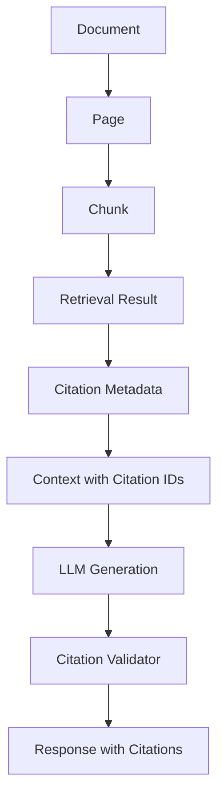
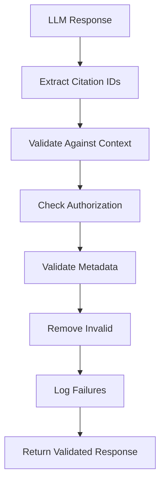
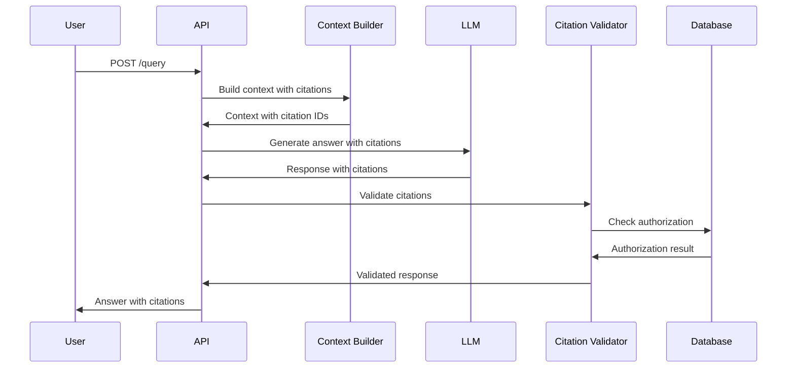

# Citation Specification

**Ask My Docs — Citation System**

---

# Citation Goals

1. **Traceability**: Every factual claim traceable to source document
2. **Accuracy**: Citations reference actual retrieved content
3. **Completeness**: All factual claims have citations
4. **Security**: Citations never expose unauthorized documents
5. **Usability**: Citations presented clearly to users
6. **Validation**: Invalid citations detected and removed

---

# Citation Data Model

## Citation Structure

```json
{
  "citation_id": 1,
  "document_id": "doc_abc123",
  "chunk_id": "chunk_xyz789",
  "filename": "Employee Handbook.pdf",
  "page": 42,
  "section": "Leave Policy",
  "snippet": "Annual leave entitlement is 24 days per calendar year..."
}
```

## Fields

| Field | Type | Required | Description |
|-------|------|----------|-------------|
| citation_id | integer | Yes | Sequential ID within response |
| document_id | string | Yes | Source document ID |
| chunk_id | string | Yes | Source chunk ID |
| filename | string | Yes | Human-readable filename |
| page | integer | No | Page number (nullable) |
| section | string | No | Section title (nullable) |
| snippet | string | Yes | Relevant text excerpt |

---

# Citation Lifecycle

## Flow



## Steps

### 1. Document Processing
- Document parsed into pages
- Pages split into chunks
- Each chunk gets: document_id, chunk_id, page, section

### 2. Retrieval
- Chunks retrieved by vector/BM25 search
- Citation metadata attached to each result

### 3. Context Construction
- Citation IDs assigned (1, 2, 3...)
- Context formatted with citation markers
- Citation metadata included for each chunk

### 4. LLM Generation
- LLM generates answer referencing citation IDs
- System prompt enforces citation requirements
- Structured output with answer and citations

### 5. Citation Validation
- Citation IDs validated against context
- Invalid citations removed
- Unauthorized citations blocked

### 6. Response
- Valid citations included with metadata
- Invalid citations logged
- User sees answer with citations

---

# Citation IDs

## Deterministic Assignment

Citation IDs are assigned sequentially within each response:
- Citation 1: First chunk in context
- Citation 2: Second chunk in context
- Citation N: Nth chunk in context

## Format

```markdown
Answer text with citation[1] and another citation[2].

[1] Document Name.pdf
    Page 42
    Section: Policy Title
    "Relevant text snippet..."

[2] Another Document.pdf
    Page 15
    Section: Another Section
    "Another text snippet..."
```

---

# Context Format

## How Evidence is Provided to LLM

```
You are a helpful assistant that answers questions based on the provided documents.
Always cite your sources using [citation_id] format.
Only use information from the provided context.
If the context doesn't contain enough information, say so.

Context:
[Citation 1] Document: Employee Handbook.pdf, Page: 42, Section: Leave Policy
Annual leave entitlement is 24 days per calendar year. Employees must request
leave at least 2 weeks in advance for periods exceeding 3 days.

[Citation 2] Document: Benefits Guide.pdf, Page: 15, Section: Health Insurance
Health insurance coverage begins on the first day of employment. Coverage includes
medical, dental, and vision.

Question: What is the annual leave policy?
```

---

# Structured LLM Output

## Required Format

The LLM must return JSON with answer and citations:

```json
{
  "answer": "Employees receive 24 days of annual leave per calendar year.[1] Leave requests must be submitted at least 2 weeks in advance for periods exceeding 3 days.[1]",
  "citations": [1]
}
```

## System Prompt Requirements

```
You must respond in JSON format with the following structure:
{
  "answer": "Your answer here with [citation_id] references",
  "citations": [list of citation_ids used]
}

Rules:
1. Every factual claim must reference a citation_id
2. Only use citation_ids from the provided context
3. Do not invent citation_ids
4. If you cannot answer from context, return:
{
  "answer": "I don't have enough information to answer this question.",
  "citations": []
}
```

---

# Citation Enforcement

## Rules

1. **Citation Must Exist**: Every citation_id in response must exist in context
2. **Citation Must Reference Retrieved Evidence**: Citation must correspond to a chunk in context
3. **Citation Must Belong to Authorized Document**: Citation must be from a document the user can access
4. **Citation Metadata Must Be Valid**: Document, chunk, page, section must be valid
5. **Unsupported Claims Not Presented as Grounded**: Claims without evidence must be clearly marked

## Enforcement Points

### During Generation
- System prompt enforces citation requirements
- Structured output format required
- Model instructed to only reference provided IDs

### Post-Generation
- Citation validator checks all citations
- Invalid citations removed
- User notified of invalid citations

---

# Citation Validation

## Validation Pipeline



## Validation Steps

### 1. Extract Citation IDs
- Parse response for [citation_id] patterns
- Extract unique citation IDs

### 2. Validate Against Context
- Check each citation_id exists in provided context
- Mark non-existent citations as invalid

### 3. Check Authorization
- Verify citation belongs to authorized document
- Check tenant isolation
- Check user permissions

### 4. Validate Metadata
- Verify document_id exists
- Verify chunk_id exists
- Verify page number is valid
- Verify section is valid

### 5. Remove Invalid Citations
- Remove invalid citations from response
- Update citation list
- Preserve answer text (update citations if possible)

### 6. Log Failures
- Log all validation failures
- Track citation failure rate
- Alert on high failure rate

---

# Citation Failure

## Failure Types

### Invalid Citation ID
- **Cause**: LLM invented citation_id
- **Response**: Remove citation, log failure
- **User Impact**: Citation removed from response

### Non-Retrieved Chunk
- **Cause**: Citation references chunk not in context
- **Response**: Remove citation, log failure
- **User Impact**: Citation removed from response

### Unauthorized Source
- **Cause**: Citation references document user can't access
- **Response**: Remove citation, log security event
- **User Impact**: Citation removed from response

### Missing Metadata
- **Cause**: Citation metadata incomplete
- **Response**: Attempt to fill from context, log if missing
- **User Impact**: Partial citation shown

### Unsupported Claim
- **Cause**: Factual claim without citation
- **Response**: Add disclaimer, log failure
- **User Impact**: User sees "unsupported claim" warning

## Failure Response

```json
{
  "answer": "Employees receive 24 days of annual leave per calendar year.[1]",
  "citations": [
    {
      "citation_id": 1,
      "document_id": "doc_abc123",
      "chunk_id": "chunk_xyz789",
      "filename": "Employee Handbook.pdf",
      "page": 42,
      "section": "Leave Policy",
      "snippet": "Annual leave entitlement is 24 days..."
    }
  ],
  "warnings": [
    "1 citation was removed due to validation failure"
  ]
}
```

---

# User Experience

## Citation Display

### Inline Citations
Employees receive 24 days of annual leave.[1]

### Citation List
```
[1] Employee Handbook.pdf
    Page 42
    Leave Policy
    "Annual leave entitlement is 24 days per calendar year..."

[2] Benefits Guide.pdf
    Page 15
    Health Insurance
    "Health insurance coverage begins on the first day of employment..."
```

### Citation Details
- Click citation to see full context
- Link to original document (if available)
- Show surrounding text for context

---

# Multiple Sources

## When Multiple Citations Required

- Answer spans multiple documents
- Information from different sections
- Multiple facts need support

## Citation Grouping

```json
{
  "answer": "Employees receive 24 days of annual leave[1] and health insurance from day one[2].",
  "citations": [1, 2]
}
```

## Citation Merging

If multiple citations support same claim:
- Use primary citation (most relevant)
- Note additional sources in metadata

---

# Citation Precision

## Smallest Useful Evidence Span

- Prefer shorter snippets over full paragraphs
- Include enough context for understanding
- Avoid extraneous information

## Snippet Length

- Default: 200 characters (configurable)
- Minimum: 50 characters
- Maximum: 500 characters

## Configuration

- `citation_snippet_length`: 200 (default, configurable)
- `citation_prefer_shortest`: true (default, configurable)

---

# Citation Evaluation

## Metrics

### Citation Correctness
- **Definition**: Citations accurately reference source
- **Formula**: correct_citations / total_citations
- **Target**: Configurable (default: 0.9)

### Citation Completeness
- **Definition**: All factual claims have citations
- **Formula**: cited_claims / total_claims
- **Target**: Configurable (default: 0.8)

### Citation Relevance
- **Definition**: Citations support the claims they're attached to
- **Formula**: relevant_citations / total_citations
- **Target**: Configurable (default: 0.85)

## Measurement

- Automated validation against context
- Human evaluation for accuracy
- Track metrics over time

---

# Security

## Citation Security Requirements

1. **Never Expose Unauthorized Documents**: Citations must only reference documents user can access
2. **Tenant Isolation**: Citations must respect tenant boundaries
3. **No Cross-Tenant Citations**: Citations from other tenants blocked
4. **Metadata Validation**: All citation metadata validated
5. **Logging**: All citation failures logged for security audit

## Security Checks

### Authorization Check
```sql
SELECT document_id FROM document_permissions
WHERE document_id = $1
  AND (user_id = $2 OR is_public = true)
  AND tenant_id = $3;
```

### Tenant Isolation
```sql
SELECT id FROM documents
WHERE id = $1
  AND tenant_id = $2;
```

---

# Acceptance Criteria

## Valid Citations

- [ ] Citations reference retrieved chunks
- [ ] Citations have valid metadata
- [ ] Citations belong to authorized documents
- [ ] Citations have correct page numbers
- [ ] Citations have correct section titles

## Hallucinated Citations

- [ ] Invented citation_ids detected
- [ ] Invented citation_ids removed
- [ ] Invention logged for monitoring
- [ ] User notified of removed citations

## Invalid Citations

- [ ] Non-existent citation_ids detected
- [ ] Non-existent citation_ids removed
- [ ] Invalid metadata detected
- [ ] Invalid metadata logged

## Unauthorized Citations

- [ ] Cross-tenant citations blocked
- [ ] Unauthorized document citations blocked
- [ ] Security event logged
- [ ] User sees appropriate error

## Unsupported Claims

- [ ] Claims without citations detected
- [ ] Disclaimer added for unsupported claims
- [ ] User informed of unsupported claims

---

# Citation Sequence Diagram



---

*This document is the authoritative citation specification. All other documents must be consistent with this specification.*
